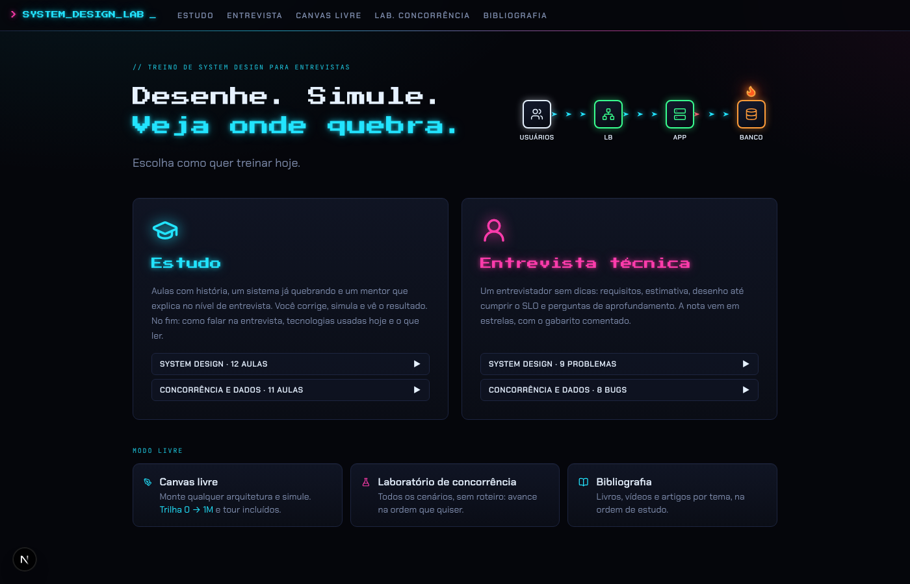
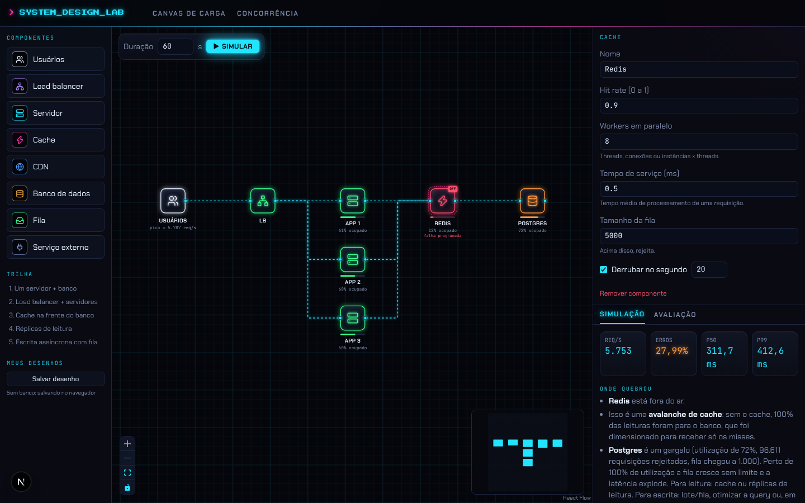
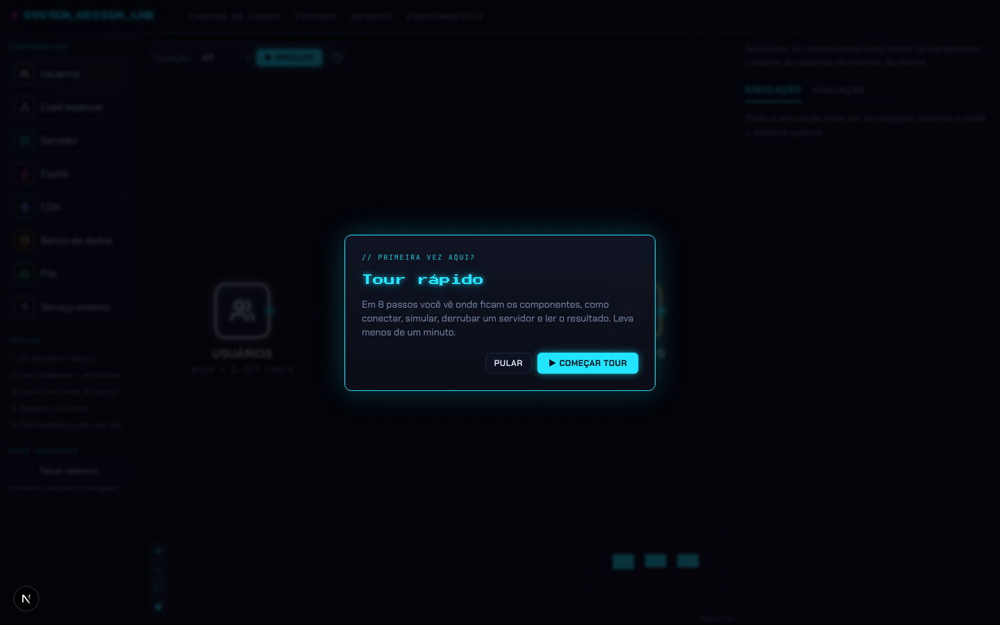
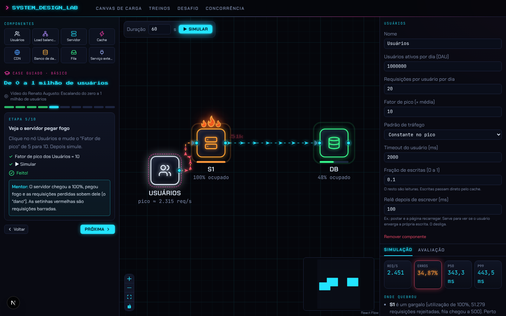
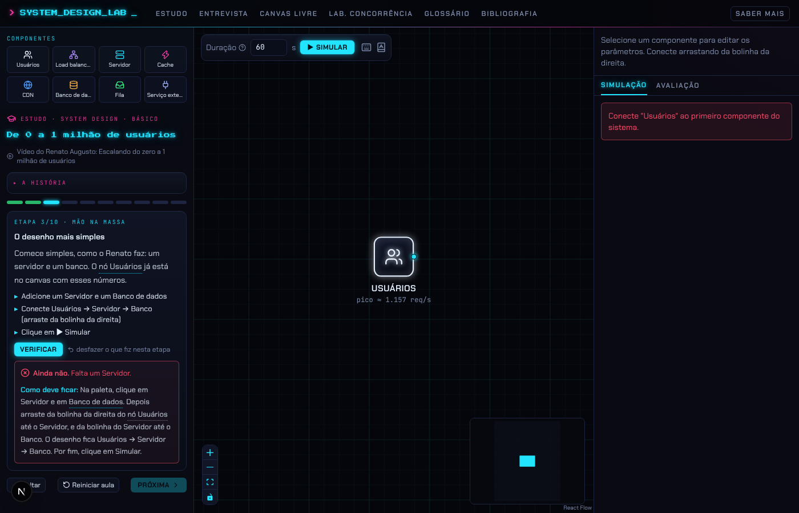
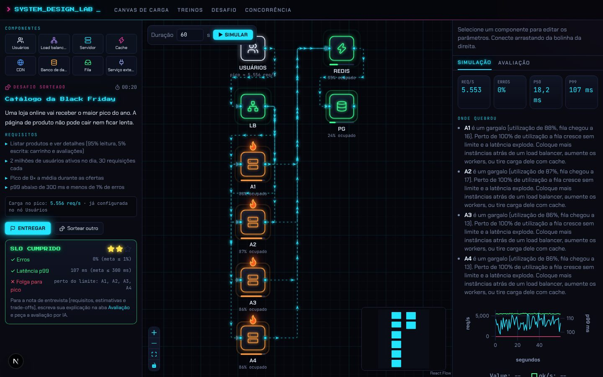
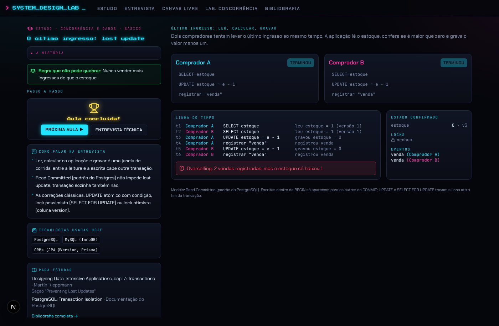
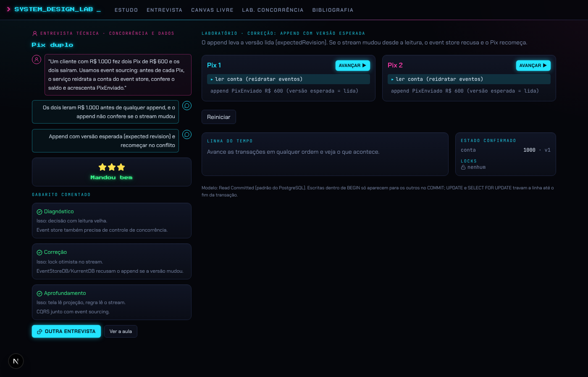
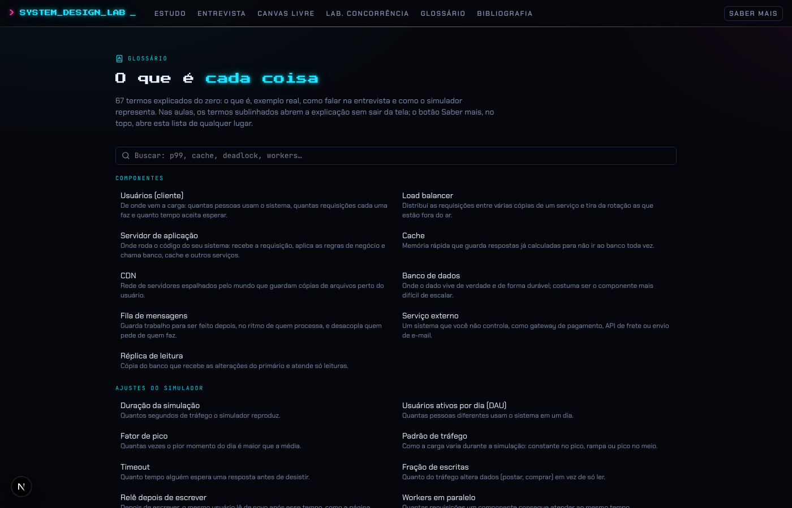

# Feature 1: System Design e Concorrência e dados

> Treino de entrevistas de system design: **desenhe** a arquitetura num canvas neon, **simule** carga e concorrência de verdade e **veja onde quebra**. Dois modos (Estudo e Entrevista técnica) e duas áreas (System Design e Concorrência e dados).

Leia antes o [design system compartilhado](README.md#design-system-compartilhado-terminal-neon). Código de referência: `main` (commit `0b37b8b`) e branch `claude/project-thread-sdljix` (`f8213fe`).



---

## 1. Mapa da feature

| Rota | O que é |
|---|---|
| `/` | Capa: "Desenhe. Simule. Veja onde quebra." + animação + cards dos modos |
| `/estudo` | Escolha de área no modo Estudo |
| `/estudo/system-design` e `/estudo/system-design/[id]` | Lista e aula guiada de system design (canvas + mentor) |
| `/estudo/concorrencia` e `/estudo/concorrencia/[id]` | Lista e aula guiada de concorrência (transações passo a passo) |
| `/entrevista` | Escolha de área no modo Entrevista técnica |
| `/entrevista/system-design` e `/entrevista/system-design/[id]` | Problemas sorteáveis com entrevistador sem dicas, SLO e nota em estrelas |
| `/entrevista/concorrencia` e `/entrevista/concorrencia/[id]` | Bug de produção: diagnóstico, correção, prova e aprofundamento |
| `/canvas` | Canvas livre com trilha "0 → 1M", desenhos salvos, avaliação por IA e tour |
| `/concorrencia` | Laboratório livre de concorrência (todos os cenários, sem roteiro) |
| `/glossario` | Glossário completo (também abre como painel lateral de qualquer tela) |
| `/bibliografia` | Livros, pessoas, newsletters e blogs |
| `/treinos`, `/desafio` | Endereços antigos: redirecionam para `/estudo/system-design` e `/entrevista/system-design` |

Pacotes:

- `packages/sim-engine`: motor de carga (simulação de eventos discretos), roda num Web Worker.
- `packages/race-sim`: motor de concorrência (intercalação passo a passo + mini-banco com locks).
- `packages/ai`: avaliação por IA do desenho (banca de dois avaliadores).
- `apps/web`: telas, conteúdo das aulas (`lib/training`, `lib/concurrency`), glossário (`lib/glossary`), bibliografia (`lib/bibliography.ts`).

---

## 2. A capa (home)

Arquivo de referência: [`anexos/HeroFlow.tsx`](anexos/HeroFlow.tsx).

### Layout

- Container `max-w-5xl`, `py-12`. Linha superior com duas colunas que quebram no celular (`flex-wrap`, `gap-8`):
  - Esquerda: `hud-label` "// treino de system design para entrevistas"; título em Press Start 2P `text-2xl` (`sm:text-3xl`), `leading-[1.6]`, em duas linhas: **"Desenhe. Simule."** (branco) e **"Veja onde quebra."** (ciano com `glow`). Abaixo, "Escolha como quer treinar hoje." em `text-lg text-muted`.
  - Direita: a animação HeroFlow (400 x 150 px, `max-w-full`).
- Abaixo, os **cards grandes dos modos** em grade (`md:grid-cols-2` na versão só com System Design; hoje `md:grid-cols-3` porque inclui Processo seletivo). Decisão de 02/11: **os cards grandes são o MODO** (Estudo, Entrevista técnica) e dentro de cada um se escolhe a área.
  - Card `panel p-7` com: ícone lucide 42px (GraduationCap ciano para Estudo, UserRound magenta para Entrevista) com `drop-shadow 0 0 10px` da cor; título Press Start 2P `text-lg` na cor com glow; texto `text-sm text-muted`; no fim, botões `btn-ghost` em MAIÚSCULAS, um por área, com contagem e "▶": "SYSTEM DESIGN · 12 AULAS", "CONCORRÊNCIA E DADOS · 11 AULAS" / "SYSTEM DESIGN · 9 PROBLEMAS", "CONCORRÊNCIA E DADOS · 8 BUGS".
  - O card inteiro é clicável (link absoluto por cima) e os botões das áreas ficam acima dele. Hover: borda na cor + `shadow-[0_0_28px_rgba(cor,0.3)]`.
  - Textos: Estudo = "Aulas com história, um sistema já quebrando e um mentor que explica no nível de entrevista. Você corrige, simula e vê o resultado. No fim: como falar na entrevista, tecnologias usadas hoje e o que ler." Entrevista = "Um entrevistador sem dicas: requisitos, estimativa, desenho até cumprir o SLO e perguntas de aprofundamento. A nota vem em estrelas, com o gabarito comentado."
- Seção **"MODO LIVRE"** (`hud-label`) com três cards menores (`sm:grid-cols-3`): Canvas livre (PenTool ciano, "Monte qualquer arquitetura e simule. **Trilha 0 → 1M** e tour incluídos."), Laboratório de concorrência (FlaskConical magenta), Bibliografia (BookOpen ciano).

### Animação "teste, quebre, veja onde quebra" (HeroFlow)

Um mini diagrama de arquitetura vivo, em SVG + HTML, sem biblioteca:

- 4 nós em linha, em `y = 70` dentro de `viewBox 0 0 400 150`, nos `x` 30, 140, 250, 360: **USUÁRIOS** (Users, branco `#e6f1ff`), **LB** (Network, verde `#39ff8f`), **APP** (Server, verde), **BANCO** (Database, laranja `#ff9a3c`, quente).
- Cada nó é um tile 44 x 44 px, `rounded-lg`, borda 2px na cor, fundo `linear-gradient(160deg,#141a2e,#070a12)`, `box-shadow 0 0 12px` da cor a 45%; ícone 20px. Rótulo abaixo em 10px, semibold, `tracking-wider`.
- Entre os nós, uma linha tracejada (`4 6`) que corre no sentido do tráfego (`dash-flow`, 1.2s). As duas primeiras ligações são ciano a 50%; a última (APP → BANCO) é laranja.
- Em cada ligação andam **3 setinhas** (path `M -5 -3.5 L 4 0 L -5 3.5 L -2.5 0 Z`) com `<animateMotion dur="1.2s" rotate="auto">`, defasadas em 0.4s, ciano com `drop-shadow 0 0 4px`.
- Na última ligação, a primeira setinha é **vermelha** e é barrada: anda só até 80% do caminho (`keyPoints="0;0.8"`) e some (`opacity 1;1;0`). É a requisição rejeitada pelo banco.
- O banco tem a classe `heat` (brilho pulsando a cada 1.4s) e uma **chama** (Flame 20px) acima dele, com a animação `flame` (balança e muda de escala a cada 0.55s, `drop-shadow` laranja).

A mensagem visual: o tráfego flui, o banco esquenta, pega fogo e começa a barrar requisições. É a promessa da plataforma.

---

## 3. O canvas de carga

Arquivos de referência: [`anexos/SystemNode.tsx`](anexos/SystemNode.tsx), [`anexos/TrafficEdge.tsx`](anexos/TrafficEdge.tsx), [`anexos/icons.tsx`](anexos/icons.tsx).



### Layout da tela (desktop)

Grade de 3 colunas ocupando `100vh - 48px`:

1. **Esquerda** (200px no modo livre; 340px quando há mentor), `bg-panel/60`, borda direita:
   - "COMPONENTES": paleta com os 8 tipos. Modo livre: lista com quadradinho 28px (ícone na cor do tipo, borda da cor a 55%) + nome. Modo mentor: grade 4 x 2 só com ícones e nome curto.
   - "TRILHA" (modo livre): os presets "1. Um servidor + banco", "2. Load balancer + servidores", "3. Cache na frente do banco", "4. Réplicas de leitura", "5. Escrita assíncrona com fila".
   - "MEUS DESENHOS": salvar e abrir. Com banco, tabela `designs`; sem banco, `localStorage` (`sdp:designs`), com o aviso "Sem banco: salvando no navegador".
2. **Centro**: o React Flow (`@xyflow/react`), `colorMode="dark"`, fundo transparente com **grade estilo blueprint** (linhas ciano a 3,5% a cada 24px e a 8% a cada 96px), controles e minimapa (nós ciano, máscara `rgba(5,6,11,.65)`). No canto superior esquerdo, um `panel` flutuante: "Duração [60] s", botão **▶ SIMULAR** (`btn-neon`), ícone de teclado (atalhos), "?" do glossário e ícone do tour.
3. **Direita** (380px, 360px com mentor): Inspector do nó selecionado (campos do tipo, "Derrubar no segundo [20]", "Remover componente" em vermelho) e abas **SIMULAÇÃO / AVALIAÇÃO** (aba ativa ciano com sublinhado e glow).

### Os 8 componentes

| Tipo | Ícone lucide | Cor neon | Parâmetros padrão |
|---|---|---|---|
| Usuários (`client`) | Users | `#e6f1ff` | DAU 1.000.000, 20 req/usuário/dia, pico 5×, padrão constante, timeout 2000 ms, 10% de escritas, relê 100 ms depois de escrever |
| Load balancer | Network | `#b18cff` | algoritmo "menos requisições em andamento" (ou round robin) |
| Servidor | Server | `#22e4ff` | 32 workers, 20 ms, fila 500, 0 retries |
| Cache | Zap | `#ff3cac` | 8 workers, 0,5 ms, fila 5000, hit rate 0,9 |
| CDN | Globe | `#4d9dff` | 64 workers, 2 ms, fila 10000, hit rate 0,95 |
| Banco de dados | Database | `#ffb547` | 50 workers, 15 ms, fila 1000, 0 réplicas, atraso de replicação 10 ms, read-your-writes 0 |
| Fila | Inbox | `#39ff8f` | capacidade 50.000, 4 consumidores |
| Serviço externo | Plug | `#9fb4ff` | 10 workers, 300 ms, fila 100, 1% de erro |

Cada campo do Inspector tem rótulo, ajuda curta e um "?" que abre o termo no glossário.

### O nó (visual)

- Largura 150px. Em cima, um **tile 64 x 64** (`rounded-xl`, borda 2px, fundo `linear-gradient(160deg,#141a2e,#070a12)`, `box-shadow 0 0 12px` da cor a 45% + brilho interno), com o ícone 30px. Embaixo, o nome em MAIÚSCULAS 14px semibold e uma linha mono 11px cinza ("pico ≈ 5.787 req/s" para Usuários; "61% ocupado" para os demais; "prim. 40% · rép. 90%" para banco com réplicas).
- Antes de simular, a cor é a do tipo. Depois, a cor vira o **status**: `ok` verde, `warn` amarelo, `bad` laranja, `down` vermelho.
- Status (por nó): `down` se derrubado; `bad` se utilização ≥ 85% ou rejeição > 1%; `warn` se utilização ≥ 70% ou alguma rejeição; senão `ok`.
- Efeitos de jogo:
  - **Fogo**: 1 chama acima do tile quando é gargalo, 2 quando rejeita > 5%, 3 quando rejeita > 20% (a do meio maior, 26px; defasagem de 0.17s).
  - **Radar**: anel saindo do tile (`ping-ring`, escala 1 → 1.6 sumindo); bate mais rápido quanto mais ocupado (`2.4 - utilização × 1.6` s, mínimo 0.7s).
  - **Dano**: "−96,6k" (requisições perdidas, formato compacto) sobe do lado direito como dano em jogo (`damage`, Press Start 2P 9px vermelho).
  - **Esquentando**: tile `bad` ganha `heat`.
  - **Fora do ar**: tile pulsa vermelho (`node-down`) e treme como tela com defeito (`glitch`); risco diagonal vermelho sobre o ícone, ícone a 55%, selo "OFFLINE" no canto.
  - **Falha programada**: selo "!" vermelho e o texto "falha programada" abaixo.
  - **Pouca folga**: triângulo amarelo piscando no canto (`blink-warn`).
  - **Réplicas**: cópias do tile empilhadas atrás (deslocadas 6px cada, até 3, opacidade decrescente) + selo "×3" e linha "lag 120 ms" (laranja se o lag máximo passar de 1s).
  - **Barra de uso**: barrinha de 4px x 64px abaixo do tile, na cor do status, com brilho.
  - **Selecionado**: contorno tracejado magenta a 7px do tile.
- As conexões saem das **laterais do ícone** (não das bordas do nó): alvo à esquerda, origem à direita; bolinhas de 9px ciano com brilho. Usuários não recebem conexão.

### A aresta com tráfego

- Caminho `smoothstep` (ângulos retos), tracejado (`4 6` ativo, `3 5` parado), correndo no sentido do tráfego; ponta de seta fechada `#3f6f8f`.
- Depois da simulação, a vazão da aresta é estimada pelas chegadas no destino divididas pelo número de arestas que chegam nele.
- **Setinhas andando** (mesmo desenho da capa): quantidade = `round(log10(rps+1) × 2.2)`, entre 1 e 9; velocidade `60 + log10(rps) × 35` px/s. Durante a simulação, 2 setinhas cinza mais lentas.
- **Bloqueio**: se o destino rejeita, parte das setinhas fica vermelha, anda até 86% e some; a linha fica laranja e aparece um "X" num círculo piscando perto do destino. Se o destino caiu, todas vermelhas e linha vermelha.
- Aresta selecionada: magenta com `drop-shadow` magenta.
- Com `prefers-reduced-motion`, nenhuma setinha.

### Simulando

- Botão vira "Simulando…"; uma **scanline** ciano varre o canvas; no painel aparece "SIMULANDO_" com cursor piscando e uma barra de carregamento.
- O motor roda num **Web Worker** e devolve o resultado.

### Painel de resultado (aba Simulação)

- 4 cards em grade (`grid-cols-4`), entrando em sequência (`pop-in` com 70ms de atraso): **REQ/S**, **ERROS** (%), **P50**, **P99**. Números contam do zero até o valor (CountUp), em mono ciano; erros > 1% ou p99 > 500 ms ficam laranja com glow e borda pulsando (`pulse-bad`).
- Faixa laranja "N leituras com dado velho (x% das leituras no banco)" quando houver.
- **"ONDE QUEBROU"**: lista do diagnóstico em português, com o nome do componente em negrito. Exemplos reais: "**Redis** está fora do ar." / "Isso é uma **avalanche de cache**: sem o cache, 100% das leituras foram para o banco, que foi dimensionado para receber só os misses." / "**Postgres** é um gargalo (utilização de 72%, 96.611 requisições rejeitadas, fila chegou a 1.000). Perto de 100% de utilização a fila cresce sem limite e a latência explode. Para leitura: cache ou réplicas de leitura. Para escrita: lote/fila, otimizar a query ou, em último caso, sharding."
- **"LINHA DO TEMPO"**: gráfico uPlot (verde = ok/s, vermelho = erros/s, azul = p99).
- "Detalhes por componente" (recolhido): tabela mono com utilização, rejeitadas, fila máxima, lag máximo; e a nota sobre Lei de Little e seed fixa.

### Atalhos de teclado

Ctrl+Z desfazer, Ctrl+Y / Ctrl+Shift+Z refazer, Ctrl+C/V copiar e colar (com configurações e conexões), Ctrl+D duplicar, Ctrl+A tudo, Shift+arrastar seleção em retângulo, Ctrl+clique soma à seleção, Delete/Backspace apaga, Ctrl+Enter simula, F enquadra, "?" mostra a lista. Cada ação mostra um toast mono ciano no rodapé do canvas ("Desfeito", "3 colados"). Ao carregar trilha ou desenho, o canvas faz `fitView` animado (300ms, `maxZoom 1.1`). Componente clicado na paleta cai na primeira vaga livre de uma grade de 230 x 150 px.

### Avaliação por IA (aba Avaliação)

- Campos "Problema" e "Sua explicação (requisitos, estimativas, trade-offs)" e o botão **AVALIAR COM IA** ("Avaliando… (pode levar ~1 min)").
- Resultado: nota geral em Press Start 2P ciano ("7/10"), consenso, um `panel` por avaliador (nome, nota, perspectiva, pontos fortes em verde, fracos em laranja), tabela por dimensão, "O ENTREVISTADOR PERGUNTARIA" e "PRÓXIMOS PASSOS".
- `POST /api/evaluate` com `{ problem, notes, graph, simulation }`; valida o grafo antes; marca a atividade `design` no hábito.
- Prompt de sistema (resumo fiel, texto completo em `packages/ai/src/rubric.ts`): avaliar em pt-BR simulando **dois avaliadores independentes** e um consenso: "Entrevistadora de big tech" (rigorosa: requisitos não funcionais com números, consistência, falhas, escala) e "Staff pragmático de startup" (simplicidade, custo, entregar; penaliza superdimensionamento). Notas inteiras 0 a 10 em 7 dimensões: Escopo e requisitos, Estimativas, Desenho, Profundidade, Trade-offs, Falhas, Comunicação. Usar a simulação como evidência e não inventar métricas. Apontar erros comuns: confundir usuários por dia com req/s, chamar sistema distribuído de "CA", exactly-once como garantia de rede, ordem global no Kafka, lock distribuído com TTL sem fencing token, média em vez de percentil, ignorar replication lag, retry sem backoff e jitter, sharding sem números. 2 a 4 perguntas de follow-up e próximos passos concretos.
- O prompt do usuário descreve: problema, requisitos, cada componente com parâmetros em JSON, as conexões ("chamadas síncronas; a fila é assíncrona"), e o resultado da simulação (duração, erros por tipo, p50/p95/p99, cada nó com status, utilização, rejeições, fila, réplicas e lag, leituras velhas e o diagnóstico).
- Schema de saída: `{ overallScore, judges[{name, perspective, score, strengths[], weaknesses[]}], dimensions[{dimension, score, comment}], consensus, followUpQuestions[], nextSteps[] }`.

### Tour da tela



Arquivo: [`anexos/Tour.tsx`](anexos/Tour.tsx).

- Na primeira visita ao canvas livre aparece um convite: tela escurecida (`rgba(2,3,8,.78)` + blur 2px), card `panel` com borda ciano e brilho `0 0 40px`: "// primeira vez aqui?", "Tour rápido" em Press Start 2P, "Em 8 passos você vê onde ficam os componentes, como conectar, simular, derrubar um servidor e ler o resultado. Leva menos de um minuto." Botões PULAR (ghost) e ▶ COMEÇAR TOUR (neon). A escolha fica em `localStorage` (`sdp-tour-canvas-v1`).
- Rodando: a tela escurece e **só o elemento do passo fica aceso** (classe `tour-spot`: sombra de 9999px + halo ciano pulsando). O card se posiciona à direita, à esquerda, abaixo ou acima do alvo, o que couber. Setas ← → navegam, Esc fecha. Remede a cada 400ms (painéis podem mudar de tamanho). Também abre pelo botão "?" ou por `?tour=1`.
- Passos (alvos `data-tour`): Componentes (`palette`), O canvas (`board`), Configure e derrube (`inspector`), Simule (`simulate`), Resultado e avaliação (`tabs`), Trilha pronta (`trilha`), Seus desenhos (`designs`), Hora de treinar (`nav-estudo`).

---

## 4. O motor de carga (`packages/sim-engine`)

Simulação de eventos discretos (DES) com **seed fixa** (mesmo desenho, mesmo resultado). Tempo interno em ms.

- Cada componente com capacidade é uma **estação de fila**: N workers, fila FIFO limitada e tempo de serviço aleatório (lognormal por padrão, cv 1; também exponencial ou constante). Fila cheia rejeita.
- Usuários geram um **processo de Poisson não homogêneo** (por thinning) com taxa base `DAU × req por dia / 86.400`, multiplicada pelo pico. Padrões: constante no pico; rampa de 0 ao pico; "spike" (média, com pico no terço do meio).
- Requisições percorrem o grafo como **chamadas síncronas**, chamando as dependências em sequência na ordem das conexões. Latência de rede por chamada 0,5 ms (metade na ida, metade na volta).
- **Load balancer**: round robin ou menos requisições em andamento.
- **Cache/CDN**: leitura é hit com probabilidade `hitRate` e responde ali; miss segue para a origem. Escrita passa direto e invalida a chave. Cache fora do ar: a aplicação cai direto na origem (é assim que nasce a **avalanche**).
- **Servidor**: retries em dependências com backoff exponencial e full jitter (espera aleatória em `[0, 10 ms × 2^tentativa]`).
- **Fila**: único ponto assíncrono; confirma na hora e os consumidores processam depois.
- **Serviço externo**: falha com `errorRate`.
- **Banco com réplicas**: leituras vão para as réplicas (cada uma com os mesmos workers do primário), escritas para o primário. Cada réplica aplica as escritas **numa thread só, em ordem** (como o replay do WAL no PostgreSQL). Aplicar custa 5% do tempo de serviço. Lag = atraso de rede + espera no replay + aplicar. Se o primário escreve mais rápido que o replay, o lag cresce sem limite (os testes conferem `T·(1 − μ/λ)`).
- **Dado velho**: o motor guarda a última escrita confirmada de cada usuário; uma leitura que não enxerga essa escrita conta como `staleRead`. **Read-your-writes**: por `readYourWritesMs` após escrever, as leituras do usuário vão ao primário.
- **Timeout**: o usuário desiste no timeout, mas o sistema continua trabalhando (desperdício que o diagnóstico aponta).
- **Falhas programadas**: `{ nodeId, atSec, untilSec? }`; ao cair, a fila do nó é esvaziada rejeitando tudo.
- Limite de 400.000 requisições para não travar o navegador (reduz a duração e avisa).
- **Validação** antes de simular: precisa de Usuários conectados; Usuários não recebem conexões; LB precisa de saída; **sem ciclos**.
- Saída: totais, erros por tipo (timeout, rejeitada, indisponível, dependência), latências (média, p50, p95, p99, máx), média em voo (Lei de Little), métricas por nó, linha do tempo por segundo, diagnóstico e avisos.
- Testes conferem o motor contra a teoria: M/M/1 (latência = 1/(μ − λ)), Lei de Little, amplificação de retries, avalanche de cache e lag de réplica.

---

## 5. Modo Estudo · System Design



### Lista de aulas (`/estudo/system-design`)

Título "Aprenda com o mentor. **Depois, sem ajuda.**" Grade de cards (`sm:grid-cols-2`) com "AULA 01" (Press Start 2P 10px magenta), nível (básico verde, intermediário amarelo, avançado magenta), título, resumo, "N etapas" e o vídeo do Renato Augusto que inspira a aula.

Aulas, na ordem da trilha (12):

1. De 0 a 1 milhão de usuários
2. Load balancer: round robin ou least connections?
3. Cache-aside: hit rate e avalanche
4. N+1 queries: a tela que derruba o banco
5. Réplicas de leitura e o post que sumiu
6. Réplica não é CQRS
7. Fila para aguentar o pico da Black Friday
8. Microsserviços: a conta que ninguém faz
9. Cadeia síncrona × broker de eventos
10. Retry storm: quando a ajuda derruba
11. Hash de senha e a enxurrada de login
12. Encurtador de URL

O roteiro segue o método do Renato Augusto: requisitos → estimativas → banco → desenho incremental → gargalos → trade-offs.

### Estrutura de uma aula (`GuidedCase`)

```ts
{ id, title, summary, level, video?: {id, title}, story, start: Graph,
  steps: Step[], talk?: string[], tech?: string[], study?: Ref[] }

type Step =
  | { type: "info";   title; body }
  | { type: "choice"; title; body; choices: {text, correct?, why}[]; lesson }
  | { type: "number"; title; body; answer; tolerance; unit; lesson }        // conta de estimativa
  | { type: "build";  title; body; tasks: string[]; check(board): {ok, hint?}; lesson; solution? }
  | { type: "open";   title; body; reference }                              // resposta livre
```

`check` recebe o canvas atual (nós, arestas, falhas, resultado da última simulação no desenho atual e o resultado anterior para comparar antes/depois) e devolve se passou e o que falta, em uma frase.

Exemplo real (aula 1): pergunta "Qual é a sua primeira pergunta?" (certa: "Quantas requisições cada usuário faz por dia, e qual é o pico?"); conta "pico de req/s" com 1M DAU × 20 × 5 / 86.400 ≈ 1.157 (tolerância 12%); build "Adicione um Servidor e um Banco, conecte Usuários → Servidor → Banco, simule".

### Painel do mentor (coluna esquerda do canvas)

- Rótulo "ESTUDO · SYSTEM DESIGN · BÁSICO" magenta com chapéu de formatura; título Press Start 2P 11px ciano com glow; link do vídeo do Renato.
- "▸ A HISTÓRIA" recolhível (aberta na etapa 1): quem sofre e o que está acontecendo, com termos do glossário clicáveis.
- **Barra de progresso estilo fase de jogo**: um segmento por etapa (6px), atual ciano com brilho, concluídas verdes; dá para voltar a etapas já passadas.
- Etapa `build`: tarefas com "▸" (ciano) que viram "✓" (verde); botão **Verificar** e "desfazer o que fiz nesta etapa". **Cada simulação nova é conferida sozinha** ("Quando simular, eu confiro sozinho e digo se deu certo.").
- **Dicas progressivas** (ver print abaixo): ao errar, caixa vermelha "Ainda não. <o que falta>". Botão "Me dá mais uma dica" mostra "O que o simulador viu:" (as 2 primeiras linhas do diagnóstico). Depois, "Mostrar como deve ficar" mostra a solução passo a passo.
- No Estudo o mentor **não faz prova**: perguntas aparecem já explicadas (a certa com ✓ verde; "Erros comuns de raciocínio" recolhido com ✕ vermelho e o porquê).
- Acertou: "✓ Deu certo!" + a lição (explicação em nível de entrevista).
- Fim: Trophy amarelo 36px, "Case concluído!", "Agora tente sem ajuda: na Entrevista técnica o entrevistador só passa o enunciado.", botão "Próxima aula ▶", e os blocos **Como falar na entrevista**, **Tecnologias usadas hoje** e **Para estudar** (as fontes ficam só no fim).
- Progresso salvo em `localStorage` (`sdp-case-<id>`); "Reiniciar aula" volta história, etapa 1 e desenho inicial. Ao entrar numa etapa, o desenho é fotografado para "desfazer o que fiz nesta etapa".



---

## 6. Modo Entrevista técnica · System Design



- 9 problemas (`Challenge`): Catálogo da Black Friday, Placar ao vivo da Copa, Feed de rede social, E-mail de confirmação de pedido, Venda de ingressos de um show, API de pagamentos, Encurtador de URL, Streaming de vídeo (YouTube), Sincronização do Drive. Botão de dado para **sortear** outro.
- Estrutura: `{ id, title, brief, requirements[], load: {DAU, req/dia, pico, writeRatio}, slo: {p99Ms, errorRate}, mustHave?: componentes exigidos com parâmetros fixos, ask?: perguntas de requisito, followUps?: perguntas de aprofundamento }`.
- Fases: **enunciado → perguntas de requisito → estimativa → desenho até cumprir o SLO → aprofundamento → nota**. Relógio `mm:ss` rodando desde o início.
- Conversa em bolhas: entrevistador à esquerda (ícone UserRound magenta, bolha com borda magenta a 40% e fundo magenta a 5%), candidato à direita (ícone ciano). Alternativas com letra A/B/C em mono. **Uma tentativa só, sem dica**; o gabarito comentado aparece no fim.
- O canvas começa só com os Usuários do enunciado (e o que ele exigir), **travados** (não dá para apagar). Mudou o desenho, a nota antiga some.
- Estimativa certa = dentro de ±20% do pico.
- Entrega do desenho (`judge`): exige ter simulado no desenho atual, Usuários com a carga do enunciado e componentes exigidos intactos. 3 critérios = 3 estrelas: **Erros** ≤ SLO, **Latência p99** ≤ SLO, **Folga para pico** (nenhum componente fora de `ok`, isto é, nada acima de 70%). Passa se cumprir erros e latência.
- Nota final em **5 estrelas**: média de (acertos das perguntas, estimativa certa, estrelas do desenho / 3) × 5, com o resumo "perguntas 2/3 · estimativa ✓ · desenho 3/3 · 12:40".

---

## 7. Concorrência e dados



### O motor (`packages/race-sim`)

- Cada transação é uma lista de **passos atômicos** sobre um mini-banco; um scheduler escolhe quem anda.
- Modelo **Read Committed** (padrão do PostgreSQL): fora de BEGIN/COMMIT cada comando faz autocommit; dentro, escritas ficam pendentes e só aparecem no COMMIT; `UPDATE` e `SELECT ... FOR UPDATE` travam a linha até o fim da transação. Quem pede um lock que outro segura fica **bloqueado**.
- Linha = `{ value, version }`; estado = linhas, locks (linha → transação) e um **log de eventos de negócio** append-only (ex. "venda").
- Passos disponíveis: `begin`, `commit`, `select`, `selectForUpdate`, `update` (grava valor calculado na aplicação), `atomicAdd` (UPDATE atômico com condição, guarda linhas afetadas), `insertUnique` (chave única), `updateIfVersion` (lock otimista; recomeça se a versão mudou), `emit`, `cacheGet/Set/Delete`, `redisGet/Set/SetNx`, `loadStream` e `append` com versão esperada (event sourcing).
- Cada cenário tem uma **invariante** (regra de negócio) que devolve `{ ok, message }`.
- `exploreAll`: busca em profundidade por **todas as intercalações possíveis** (limite 20.000), contando ordens, violações e deadlocks, e guardando um exemplo que quebra e um que funciona (com botão para "rever essa ordem").
- Cenários: último ingresso (lost update) e as correções UPDATE atômico, SELECT FOR UPDATE e lock otimista; write skew (plantão médico) e a correção travando as linhas lidas; deadlock; cache-aside com valor velho; mensagem duplicada e chave de idempotência (UNIQUE); reserva de assento GET-depois-SET e SET NX; Pix duplo no event sourcing e append com versão esperada; Therac-25 e a correção com trava e edição atômica.

### Visual do laboratório

- Duas colunas de transação lado a lado ("Comprador A" ciano, "Comprador B" magenta), cada uma num `panel` com botão **Avançar** (`btn-neon` pequeno). A lista de passos em mono: passo atual com "▸" piscando e fundo ciano a 15%; passos feitos riscados.
- Transação esperando lock: o botão **treme** (`shake`) e aparece "🔒 esperando o lock de `estoque`, que está com Comprador A" em amarelo.
- Botão que o roteiro pede: **pulsa** (`pulse-cue`) e a coluna ganha borda e brilho na cor.
- **Linha do tempo**: tabela mono "t1, t2…" com transação (na cor), comando e nota; cada linha entra com `pop-in`. No fim, veredito: verde com ShieldCheck ou vermelho pulsando com ShieldAlert. Deadlock: "Deadlock: cada transação espera um lock que a outra segura."
- **Estado confirmado** (coluna de 240px): valores e versões ("estoque 0 · v3"), **Locks** com cadeado na cor de quem segura, **Eventos** ("venda (Comprador A)").
- Resultado do "Testar todas as ordens possíveis": caixa vermelha ou verde com "X de Y ordens quebram a regra".
- Nota do modelo sempre visível no rodapé.

### Modo Estudo (11 aulas)

O último ingresso: lost update; Lock pessimista: SELECT FOR UPDATE; Lock otimista: coluna version; UPDATE atômico; Write skew: o plantão vazio; Deadlock: cada um espera o outro; Cache-aside: o preço velho que não sai; Mensagem duplicada: idempotência; Reserva de assento: GET e depois SET; Pix duplo no event sourcing; Therac-25: a corrida que matou.

Estrutura `RaceLesson`: `{ id, title, summary, level, story, rule, concept?: {title, body}, parts: [{ scenario, beats: Beat[] }], talk[], tech?[], study?[] }`, com `Beat = { say, ask?: {q, choices}, press?: índice da transação }`.

Tela (`lg:grid-cols-[380px_1fr]`, coluna esquerda fixa com rolagem própria):
- "A história" recolhível; caixa verde com balança "**Regra que não pode quebrar:** Nunca vender mais ingressos do que o estoque."; "O que é lock pessimista?" recolhível com o conceito em linguagem simples ("Vou mexer nisso, então ninguém mexe até eu terminar.").
- Parte 1 (o problema) e Parte 2 (a correção) com barra de duas fases.
- **Narração**: lista de falas do mentor; as antigas apagadas, a atual em destaque (borda ciano, "Mentor:" em ciano), rolando sozinha. Quando o mentor pede um clique: "▸ Clique em **Avançar** no **Comprador A**" e só aquela transação pode andar. Senão, "Continuar ▶".
- Pergunta antes de um clique importante aparece já explicada (como no SD).
- Fim do roteiro: "Testar todas as ordens possíveis" → explicação ("Não é azar: existe uma ordem possível que quebra a regra, e com tráfego real ela acontece.") → "Parte 2: a correção ▶" ou "Concluir aula ▶" → Trophy + "Aula concluída!" + Como falar na entrevista, Tecnologias, Para estudar.

### Modo Entrevista (8 bugs)



Ingressos a mais, Plantão vazio, Deadlock na transferência, Preço velho no cache, Cashback em dobro, Assento vendido duas vezes, Pix duplo, Therac-25.

- Estrutura `RaceInterview`: `{ id, title, report (relato de produção entre aspas), bug (cenário), diagnose, fix, followUp, lesson (aula relacionada) }`; cada pergunta tem alternativas com `why`, e as de correção têm `proof` (o cenário que prova a correção).
- Fases: **relato → diagnóstico → correção → prova no laboratório → aprofundamento → resultado**. Na prova, o laboratório troca para o cenário da correção escolhida.
- Resultado: 3 estrelas (uma por pergunta certa), título "Mandou bem" (verde), "Quase lá" (amarelo) ou "Vale revisar a aula" (vermelho), e "GABARITO COMENTADO" com a escolha, o porquê e a melhor resposta.

---

## 8. Glossário ("Saber mais")



- ~67 termos em 7 categorias: Componentes, Ajustes do simulador, Métricas e gráfico, Escala e desempenho, Resiliência, Dados e consistência, Concorrência.
- Entrada: `{ id, term, aliases?, category, short (1-2 frases), body[] (parágrafos), example?, interview? (como cai em entrevista), sim? (como o simulador representa e o que simplifica), related?[], refs?[] }`.
- **Painel lateral** que entra pela direita (`slide-in`), largura `max-w-xl`, fundo escurecido `rgba(2,3,8,.55)`, borda esquerda ciano a 60%. Um termo por vez, com histórico ("← voltar"). Busca com lupa (acentos ignorados; termo e apelido pesam mais que o texto).
- Página do termo: categoria em `hud-label`, termo em Press Start 2P 13px ciano com glow, frase curta 15px, parágrafos, caixas "Exemplo", "Na entrevista", "No simulador" (borda e rótulo magenta), "Termos relacionados" (chips `btn-ghost`) e "Para se aprofundar".
- **Termos clicáveis no texto das aulas**: a primeira menção de cada termo vira link com sublinhado pontilhado ciano e cursor de ajuda; palavras curtas e genéricas são excluídas.
- **"?" ao lado de campos e métricas** (`HelpDot`) abre o termo direto.

## 9. Bibliografia

Seções com `{ id, title, intro, fromMiro, items: {title, by, url?, note?}[] }`: livros técnicos (lista do roadmap do Renato Augusto no Miro: Alex Xu vol. 1 e 2, DDIA, Fundamentos da Arquitetura de Software, As Partes Difíceis, Sam Newman, DDD, etc.), pessoas, newsletters e blogs, separando o que veio do Miro do que a plataforma acrescenta.

---

## 10. Dados

| Tabela | Campos | Uso |
|---|---|---|
| `designs` | `id uuid`, `name`, `problem`, `document jsonb` (grafo com posições), `created_at`, `updated_at` | desenhos salvos do canvas livre (`GET/POST /api/designs`, `GET/PUT/DELETE /api/designs/[id]`) |

Progresso de aulas, tour e desenhos sem banco ficam em `localStorage`. A avaliação marca a atividade `design` no hábito (feature 4), quando há conta.

## 11. Para replicar em outro projeto (checklist)

1. Tema e fontes do [README](README.md) (copiar `anexos/globals.css`).
2. Pacotes puros `sim-engine` e `race-sim` (sem React, testados). O motor de carga roda num Web Worker.
3. Canvas com React Flow + nó e aresta customizados (anexos) + Zustand (grafo, seleção, desfazer/refazer, copiar/colar, travados, resultado).
4. Conteúdo em arquivos TS (aulas, entrevistas, glossário, bibliografia): tudo é dado, as telas são genéricas.
5. Rota de avaliação usando a integração local do Claude Code (README).
6. Rotas e modos conforme o mapa da seção 1; a home com HeroFlow.
