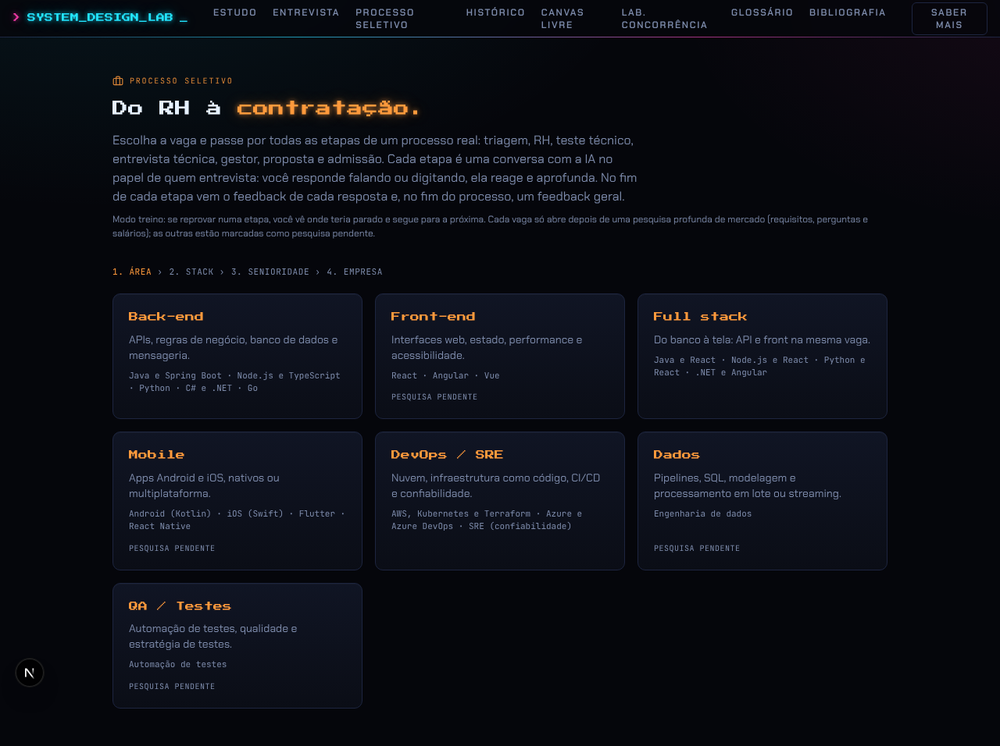
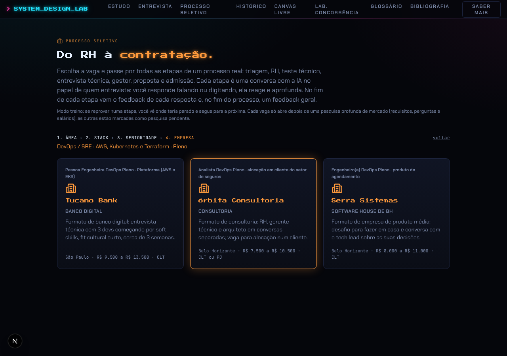
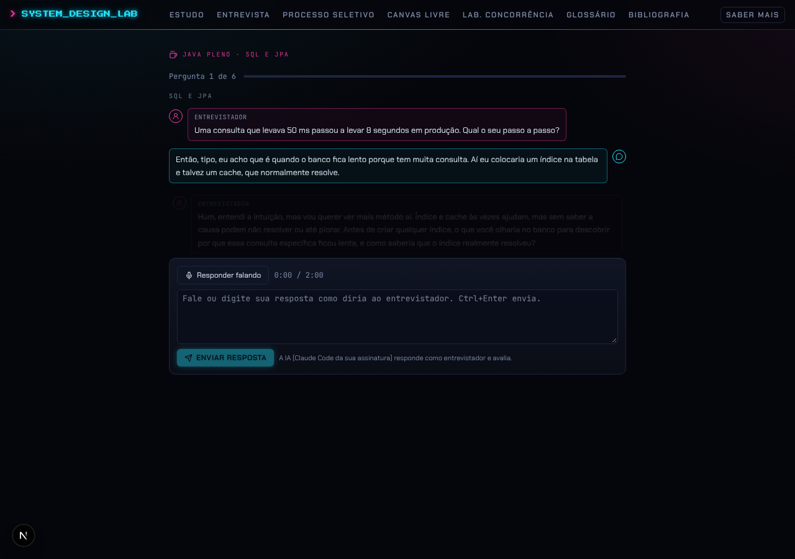
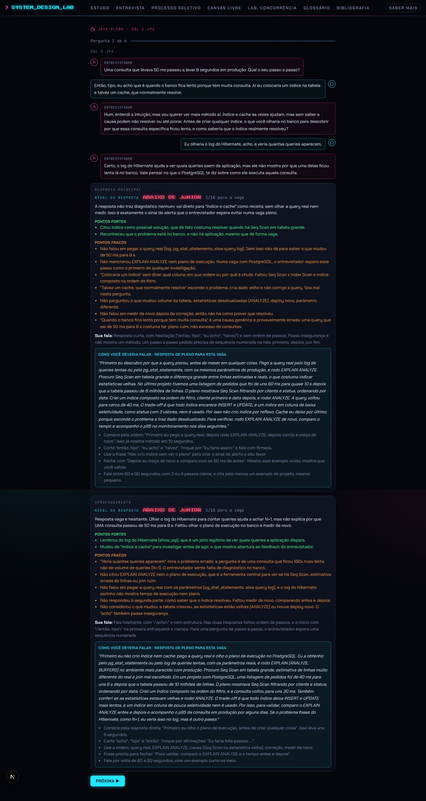
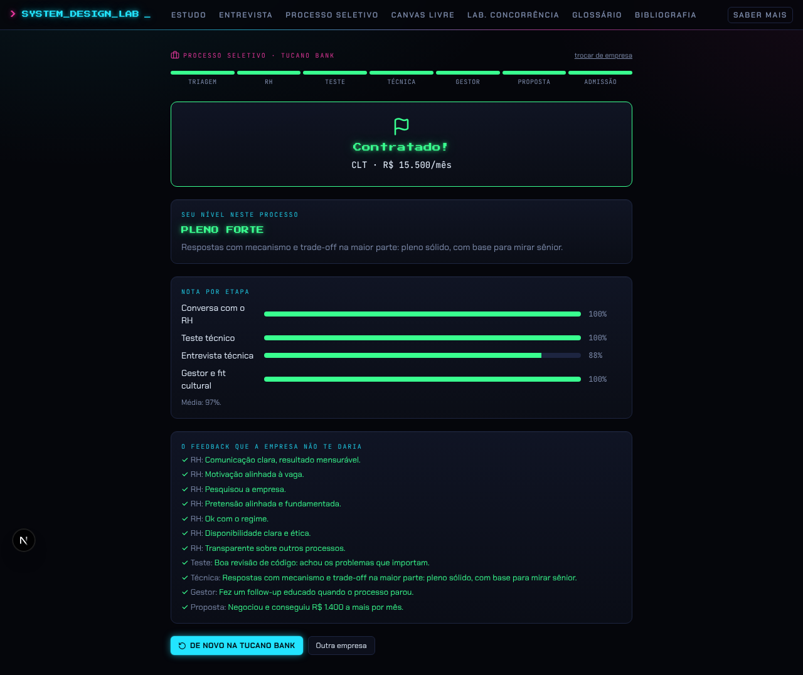

# Feature 2: Simulador de processo seletivo e entrevista por stack

> Escolha **área → stack → senioridade → empresa** e passe por um processo seletivo inteiro, do formulário da vaga à admissão, em conversa com a IA no papel de quem entrevista. Cada resposta recebe feedback, cada etapa tem nota de corte e o fim traz um relatório e um feedback geral que nenhuma empresa dá. Inclui também o treino avulso de perguntas técnicas (Java Pleno).

Leia antes o [design system compartilhado](README.md#design-system-compartilhado-terminal-neon) e a [integração local com a IA](README.md#integração-local-com-a-ia-vale-para-as-4-features). Código de referência: `main` (PRs #1 a #5), pacote `packages/hiring`, tela `apps/web/components/processo/HiringSim.tsx`.

Cor-assinatura: **laranja** (`--bad`, `#ff9a3c`), "o mesmo do foguinho do banco". Treino de Java usa **magenta** (é parte de Entrevista técnica).

---

## 1. Mapa da feature

| Rota | O que é |
|---|---|
| `/processo-seletivo` | Escolha da vaga e o processo inteiro (uma tela só, com etapas) |
| `/entrevista/java` | Escolha de nível do treino de Java (Júnior e Sênior "Em breve", com cadeado) |
| `/entrevista/java/pleno` | Lista dos 7 blocos + "Entrevista completa · 8 perguntas" |
| `/entrevista/java/pleno/[bloco]` | Sessão de um bloco, ou `completa` (sorteada) |
| `/historico` | Todas as entrevistas e processos terminados, com feedback |
| `GET /api/mercado?stack=&level=` | Pesquisa de mercado salva (lê do banco; se não houver, grava a do código) |
| `POST /api/avaliar-resposta` | Avalia uma resposta e devolve a fala do entrevistador e o aprofundamento |
| `POST /api/feedback-geral` | Feedback geral de uma sessão inteira |
| `GET /api/historico`, `GET/PUT /api/historico/[id]` | Histórico |
| `POST /api/atividade` | Conta etapa/processo terminado para o hábito (feature 4) |

---

## 2. Escolha da vaga (4 passos)



- Rótulo "PROCESSO SELETIVO" laranja com maleta; título "Do RH à **contratação.**" (laranja com glow).
- Texto: "Escolha a vaga e passe por todas as etapas de um processo real: triagem, RH, teste técnico, entrevista técnica, gestor, proposta e admissão. Cada etapa é uma conversa com a IA no papel de quem entrevista…" e a nota "Modo treino: se reprovar numa etapa, você vê onde teria parado e segue para a próxima. Cada vaga só abre depois de uma pesquisa profunda de mercado…".
- **Trilha de passos** em mono MAIÚSCULAS: "1. Área › 2. Stack › 3. Senioridade › 4. Empresa" (atual laranja, feitos brancos, futuros cinza) + link "voltar" + breadcrumb laranja ("Back-end · Java e Spring Boot · Pleno").
- Cards `panel p-5` em grade `sm:grid-cols-2 md:grid-cols-3`, hover com borda laranja e `shadow 0 0 24px rgba(255,154,60,.3)`. Título em Press Start 2P 12px laranja. Desabilitado: 45% de opacidade e o selo mono "PESQUISA PENDENTE".
  - **Área** (7): Back-end, Front-end, Full stack, Mobile, DevOps / SRE, Dados, QA / Testes, com resumo e as stacks da área.
  - **Stack** (21): título + tecnologias ("Java 17+ · Spring Boot · JPA · Kafka · PostgreSQL") + "Pronto: Pleno" em verde ou "pesquisa pendente".
  - **Senioridade**: Júnior (0 a 2 anos), Pleno (2 a 5), Sênior (5+). Só abre o que tem pesquisa pronta.
  - **Empresa** (3): título da vaga, ícone Building2 laranja 28px, nome, tipo, o "formato" do processo e, no rodapé mono, "cidade · R$ 8.500 a R$ 11.500 · CLT ou PJ".



Vagas prontas hoje (com pesquisa profunda): **Java e Spring Boot · Pleno**, **Python e React (full stack) · Pleno**, **AWS, Kubernetes e Terraform (DevOps) · Pleno**. Regra: uma combinação só fica jogável quando tem pesquisa de mercado (requisitos, temas com peso, faixa salarial com fontes, perguntas-base). Renovar as pesquisas em maio/2027.

### Catálogo (dados)

```ts
Level = "junior" | "pleno" | "senior"
AREAS: { id, title, summary }[]
STACKS: { id, area, title, techs[], ready: Level[] }[]
```

### As 3 empresas fictícias (inspiradas em formatos reais)

| | Tucano Bank | Órbita Consultoria | Serra Sistemas |
|---|---|---|---|
| Tipo | Banco digital | Consultoria (alocação em cliente) | Software house de BH (produto) |
| Cidade, modelo | São Paulo, remoto com encontros trimestrais | BH, híbrido no cliente 2×/semana | BH, híbrido 2×/semana na Savassi |
| Faixa Java Pleno (CLT) | R$ 8.500 a 11.500 | R$ 6.000 a 8.500 | R$ 6.500 a 9.000 |
| Regimes | CLT | CLT ou PJ | CLT |
| Teste técnico | revisão de código ao vivo | revisão de código com o gerente técnico | desafio para casa (72 h) + defesa |
| Técnica | 3 devs do time de Pagamentos, **começa por soft skills** | arquiteto de soluções | tech lead |
| Bug de concorrência na técnica | sim | sim | não |
| Duração | ~3 semanas | ~2 semanas | ~2 semanas |

Cada empresa tem quem conduz cada etapa (aparece no topo: "Larissa, tech recruiter", "Diego, engineering manager"…) e um anúncio (`title, about, must[], nice[], offer[]`). Por stack, o anúncio, a faixa e quem entrevista mudam (`companyFor(empresa, trilha)`).

### Conteúdo de uma vaga (`TrackContent`)

```ts
{ id: "java:pleno", stack, level, role: "Dev Java Pleno", experience: "Java e Spring Boot",
  blocks: { id, title, weight 1..3 }[],                 // temas com peso das vagas
  questions: OpenQuestion[],                            // { id, block, prompt, code?, checklist[], reference, avoid[] }
  required: { pattern, label }[],                       // filtro da triagem (ex. /spring/ → "Spring Boot")
  jobs: Record<empresa, JobPosting>,                    // anúncio, faixa, quem entrevista
  reviews: [CodeReview, CodeReview],                    // revisão de código (banco digital, consultoria)
  takehome: { title, brief[], defense[{ q, reference, avoid[] }] },
  race: boolean,                                        // inclui o bug de concorrência
  market: { stack, level, researchedAt, band, sources[{label, value, url}], topics[{title, weight}] } }
```

Java Pleno: 40 perguntas em 7 blocos (Java core e Spring Boot peso 3; APIs REST e segurança, SQL e JPA, Microsserviços e mensageria peso 2; Testes/Git/boas práticas e Docker/CI/CD/observabilidade peso 1), cada bloco com "aparece em N de 12 vagas". Python+React: 18 perguntas (Python, Django e FastAPI, React e TypeScript peso 3…). DevOps: 17 perguntas.

---

## 3. As 7 etapas



Topo fixo da tela: "PROCESSO SELETIVO · Java e Spring Boot · Pleno · Tucano Bank" + "trocar de vaga"; **stepper** com as 7 etapas (Triagem, RH, Teste, Técnica, Gestor, Proposta, Admissão). Container `max-w-3xl`. Cada etapa abre com o título em Press Start 2P ciano e "👤 quem conduz".

Notas de corte (fração dos pontos): triagem 100%, RH 60%, teste 60%, técnica 60%, gestor 60%. A nota de uma etapa é a soma das notas da IA (0 a 10) das conversas avaliadas; respostas puladas e eventos não entram.

**Modo treino**: reprovar não encerra. A tela avisa "Num processo real você teria parado em X. Você segue treinando as próximas etapas." e o relatório mostra a primeira eliminação e todas as reprovações.

1. **Vaga e triagem**: o anúncio completo num `panel` e um formulário com **campos livres** (como na Gupy): anos de experiência, pretensão mensal CLT, disponibilidade no modelo (Sim/Não), tecnologias usadas em projeto real (texto). Filtro automático tipo ATS (`screenApplication`):
   - menos de 2 anos → corta; mais de 8 → anota "perfil acima da vaga";
   - pretensão acima de 1,3× o teto → corta; abaixo de 0,9× o piso → anota "deixa dinheiro na mesa" e a proposta parte de baixo;
   - indisponível → corta; tecnologia obrigatória (`required`) ausente no texto → corta;
   - conta quantos requisitos obrigatórios do anúncio apareceram ("Bateu 3 de 5").
2. **Conversa com o RH**: perguntas de conversa (trajetória, por que sair, por que a empresa, pretensão, CLT/PJ, quando começa, outros processos).
3. **Teste técnico**: revisão de código ao vivo (o código com linhas numeradas; "diga a linha, o problema e como corrigir, comece pelo mais grave"; a IA confere contra os problemas plantados: N+1, sem paginação, transação errada, corrida, dado sensível exposto, falta validação, erro engolido, status HTTP errado, teste que não testa) **ou** desafio para casa (brief da API de agendamento; botão "Entreguei o desafio ▶"; conversa de defesa com o tech lead sobre concorrência de horários, organização e testes).
4. **Entrevista técnica**: 6 perguntas da vaga sorteadas pela semente (cobrindo os blocos de peso 3 e pesando os outros), antecedidas de soft skills no banco digital, e fechando com um **bug de produção de concorrência** (reaproveita a Entrevista de concorrência da feature 1) quando a empresa tem.
5. **Gestor e fit cultural**: perguntas comportamentais no formato **STAR** (discordância técnica, entrega que deu errado, prazo apertado, ajudar um júnior…), com dica "Monte no formato STAR".
6. **Proposta**: bolha da recrutadora "Tenho uma ótima notícia…"; card com valor em Press Start 2P ciano ("R$ 9.400/mês"), regime (abas CLT/PJ quando há), benefícios, faixa da vaga e "Referência de mercado" recolhida com as fontes (vinda de `/api/mercado`). Ações: aceitar, contraproposta, recusar.
7. **Admissão**: checklist CLT (proposta por escrito, aviso prévio, documentos, exame admissional, carteira digital) ou PJ (contrato, CNPJ/CNAE com contador, risco de vínculo, férias, aviso).

### Eventos realistas (sorteados pela semente, sempre os mesmos numa corrida)

- **Rebaixamento** (50%): técnica com nota média (60% a 75%) → dois dias depois a recrutadora liga oferecendo a vaga de **júnior** com salário de júnior. Conversa com a IA sem nota; negociar bem (nota ≥ 6) mantém pleno, senão a proposta cai 30%.
- **Sumiço** (40%): uma semana sem resposta depois da técnica. "O que você faz?" (narrador); depois a recrutadora volta pedindo desculpas.
- **"Outro perfil"** (50%): gestor com nota média → eliminado com a frase real "O gestor preferiu seguir com outro perfil no momento." e o motivo verdadeiro (respostas comportamentais genéricas).

### Regras de dinheiro

- Proposta: `piso + (teto − piso) × (pediu baixo ? 0,1 : 0,2 + 0,5 × desempenho)`, arredondada a R$ 100. Desempenho = média das frações de RH, teste, técnica e gestor. PJ = CLT × 1,25.
- Contraproposta: até +10% e dentro do teto → aceita; até +20% e até 1,05× o teto → meio-termo; acima → "sem orçamento" com +3% e revisão em 6 meses.
- CLT × PJ (conta de bolso): pacote anual CLT = salário × 13,33 + FGTS 8% + benefícios × 12; PJ equivalente = pacote / 11 meses + R$ 300 de contador, com ~6% de imposto (Simples, Anexo III com Fator R).

---

## 4. A conversa com a IA (o coração da feature)

### Caixa de resposta

- Botão "🎤 Responder falando" + cronômetro "0:00 / 2:00" (limite de 2 min). Transcrição no navegador com a **Web Speech API** (`pt-BR`, resultados parciais em tempo real; só Chrome e Edge). Ao gravar, o botão vira "Parar" com borda vermelha.
- Textarea mono: "Fale ou digite sua resposta como diria ao entrevistador. Ctrl+Enter envia." Botão **ENVIAR RESPOSTA** e a nota "A IA (Claude Code da sua assinatura) responde como entrevistador e avalia."

### Fluxo de uma pergunta

1. O entrevistador pergunta (bolha à esquerda, borda magenta, rótulo "ENTREVISTADOR"; código num `panel` mono quando há).
2. O candidato responde (bolha à direita, borda ciano).
3. `POST /api/avaliar-resposta` com a etapa, o nível alvo, a pergunta, o código, o que o entrevistador queria ouvir (`expected`), a resposta de referência, os sinais de alerta (`avoid`), a vaga (texto do anúncio + faixa que o candidato não sabe), quem entrevista, o histórico da conversa, se pode aprofundar e se a resposta veio de áudio.
4. Enquanto espera: "🤖 Larissa está pensando… (até 1 min)" com o robô piscando.
5. A IA responde **no papel** (`reply`, 1 a 3 frases, sem nota) e, se permitido, faz **uma pergunta de aprofundamento** (`followUp`) a partir do que foi dito. Padrão: até 1 aprofundamento por pergunta.
6. Erro da IA: caixa vermelha com "Tentar de novo" e "Pular sem avaliação".
7. No processo seletivo, o **feedback aparece no fim da etapa** (simulação); no treino de Java, logo após cada pergunta.

### Prompt de avaliação de resposta (`packages/ai/src/answer.ts`, resumo fiel)

Sistema: entrevistador experiente de vagas de tecnologia no Brasil, avalia UMA resposta em pt-BR.
- Nível da resposta: "abaixo de júnior", "júnior" (definição e uso básico), "pleno" (mecanismo, exemplo concreto, trade-off principal e como testar), "sênior" (além disso: escala, falhas, operação, alternativas, decisões de arquitetura e de time). Nota 0 a 10 em relação ao nível da vaga.
- Preciso tecnicamente; em RH/comportamental avalia clareza, STAR, resultado concreto e sinais de alerta. Áudio: ignora erros de reconhecimento e avalia a fala (objetividade, ordem, vícios).
- `covered`: copia os itens esperados cobertos. `strengths`/`gaps`: específicos ao que ELE disse.
- `betterAnswer`: a resposta que faria passar, **falada**, em primeira pessoa, 6 a 10 frases: (1) resposta direta, (2) mecanismo com termos corretos, (3) exemplo concreto com número, ligado ao domínio da vaga, (4) trade-off, (5) como verifica/testa. "Nada de resposta de livro: tem que soar como alguém que já fez."
- `howToSay`: 3 a 5 dicas de fala específicas (por onde começar, o que cortar, frases prontas, vícios, tempo).
- No papel: `reply` (fala natural, sem nota) e `followUp` (uma pergunta curta ou "").

Saída: `{ level, score, verdict, strengths[], gaps[], covered[], communication, betterAnswer, howToSay[], reply, followUp }`.

### Card de feedback de uma resposta



- `panel` com "NÍVEL DA RESPOSTA" + nível em Press Start 2P na cor (abaixo de júnior vermelho, júnior amarelo, pleno verde, sênior ciano) + "7/10 para a vaga".
- Veredito, "PONTOS FORTES" (verde) e "PONTOS FRACOS" (laranja), "Sua fala:".
- Caixa ciano "COMO VOCÊ DEVERIA FALAR · RESPOSTA DE PLENO PARA ESTA VAGA" com a resposta em itálico entre aspas e as dicas de fala.

### Prompt do feedback geral (`packages/ai/src/session.ts`)

Sistema: tech lead e recrutador experiente; recebe TODAS as respostas já avaliadas e escreve "o feedback geral que uma empresa nunca dá".
Saída: `{ level, score, verdict (2-3 frases), decision (contratar / como júnior / reprovar, e o motivo real como seria discutido internamente), byStage[{stage, level, comment}], patterns[3-5, citando perguntas], strengths[], gaps[], howToSpeak[4-6 com frases-modelo], studyPlan[3-6 em prioridade, com porquê e como praticar] }`.
Entrada: título da sessão, vaga, resultado, etapa de eliminação, e por etapa a lista "Pergunta / Resposta / Avaliação: nível, nota. Faltou: …".

---

## 5. Relatório final



- Card central (borda verde ou vermelha): Flag 30px, título Press Start 2P com glow: "Contratado!", "Você recusou a proposta" ou "Num processo real: eliminado em Entrevista técnica"; "CLT · R$ 9.400/mês"; motivo; etapas reprovadas; "Nível mostrado: **pleno**".
- Selo de salvamento no histórico.
- **Feedback geral da IA** (pedido automaticamente ao abrir; guardado no estado para não pedir de novo): nível e nota, veredito, decisão, por etapa, padrões, pontos fortes e fracos, "como falar" e plano de estudo numerado.
- "NOTA POR ETAPA": barras horizontais (verde se passou do corte, vermelho se não) com a nota 0 a 10.
- "O QUE FICOU ANOTADO SOBRE VOCÊ": ✓ verde ou ▲ amarelo, prefixado pela etapa (o que o recrutador anotou).
- "TODAS AS RESPOSTAS · CLIQUE PARA REVER O FEEDBACK": `details` por resposta com a nota colorida (≥ 7 verde, ≥ 5 amarelo, senão vermelho).
- Perguntas técnicas fracas (nota < 6) viram sugestão do que revisar; botões para refazer a mesma vaga ou escolher outra.

## 6. Treino de Java Pleno (Entrevista técnica)

- `/entrevista/java`: três cards de nível; só Pleno aberto ("40 perguntas em 7 blocos, com o peso do que as vagas mais pedem…").
- `/entrevista/java/pleno`: título "Explique o mecanismo. **Não a definição.**" (magenta), botão "⏱ Entrevista completa · 8 perguntas" e a grade "BLOCO 01…07" com resumo e "N perguntas · aparece em 12 de 12 vagas".
- Sessão: "Pergunta 1 de 6" com barra magenta; mesma conversa com a IA, feedback logo após cada pergunta.
- Sorteio da completa: sempre 1 de Java core e 1 de Spring Boot + 6 pelo peso do bloco dividido pelo número de perguntas do bloco, em ordem de bloco.
- Resultado: "NÍVEL QUE SUAS RESPOSTAS MOSTRARAM" em Press Start 2P, barras por bloco (verde ≥ 6), lista de perguntas recolhíveis, link para o guia de estudo e o feedback geral.
- Nível por fração de pontos (versão de múltipla escolha): ≥ 85% pleno forte, ≥ 60% pleno, ≥ 40% júnior, senão abaixo de júnior.

## 7. Histórico (`/historico`)

- "Suas **entrevistas.**" (laranja). Filtros (`btn-ghost`) por tipo; lista de `panel` com título, data, resultado, nível colorido e nota; clicar expande o feedback geral e cada resposta.
- Sem conta, mostra as entrevistas feitas sem entrar e o link "Entre para ver as do seu perfil".
- Salvamento: o id da corrida é gerado no navegador e o fim do processo faz `PUT /api/historico/<id>` (repetível, sem duplicar).

## 8. Dados

| Tabela | Campos principais |
|---|---|
| `interview_runs` | `id uuid` (gerado no navegador), `kind` ("processo" \| "treino"), `user_id`, `profile_id`, `stack`, `level`, `company`, `title`, `outcome` (uma frase), `level_shown`, `score real`, `state jsonb` (estado completo), `feedback jsonb` (feedback geral), timestamps |
| `market_profiles` | `id` ("java:pleno"), `stack`, `level`, `data jsonb` (faixa, fontes, temas), `researched_at`, `updated_at` |

Estado de uma corrida (`Run`, também em `localStorage` `processo-seletivo:v3`): `{ v, id, stack, level, company, seed, stage, scores por etapa, notes[], eliminated?, failed[], declined?, askedLow, downgraded, java[{id, score}], convs[{stage, title?, r: ConvResult, unscored?}], offer?, final?, general? }`. `ConvResult` = pergunta, transcrição, avaliações (principal e aprofundamento), nota média, nível, `skipped`.

Integração com o hábito: cada resposta avaliada conta `answer`; cada etapa terminada conta `stage` (ref `<id>:<etapa>`); o processo inteiro conta `process`.

## 9. Para replicar (checklist)

1. Pacote puro `hiring`: catálogo, empresas, etapas, cortes, filtros, eventos, proposta, contraproposta, CLT×PJ, conteúdo das vagas, sorteio por semente (RNG determinístico).
2. Componente de conversa (`AiConversation` + caixa com Web Speech) e card de feedback.
3. Rotas de avaliação e feedback geral com os prompts acima e a integração local do Claude Code.
4. Tela única com stepper e uma visão por etapa; estado no `localStorage` e no banco no fim.
5. Pesquisa de mercado salva por stack e nível; só liberar vagas com pesquisa.
