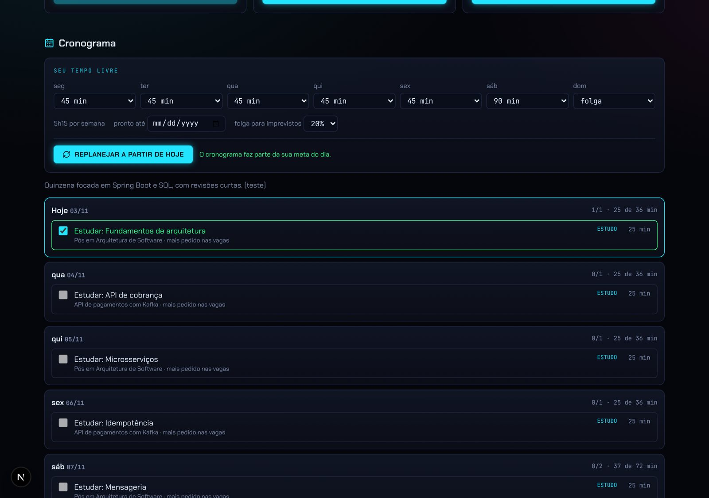
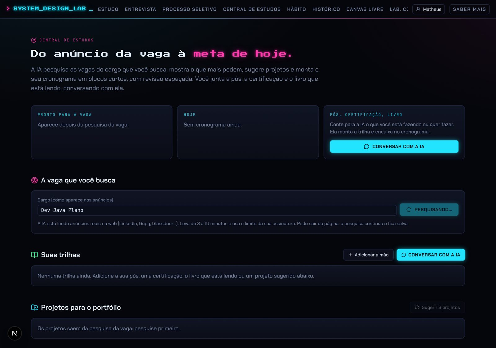
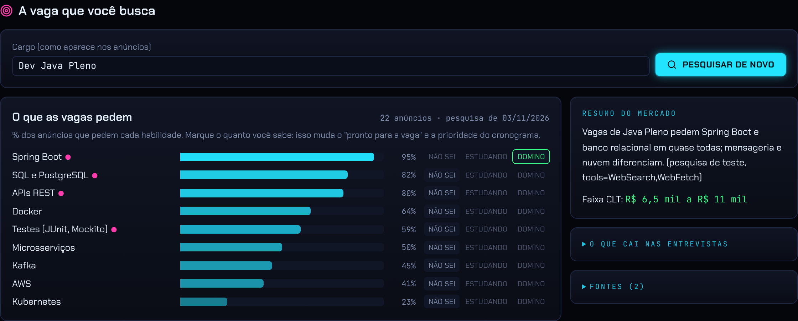
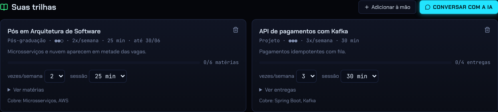
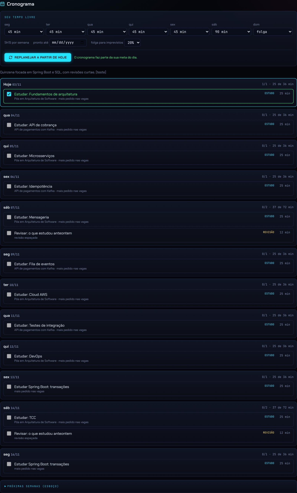
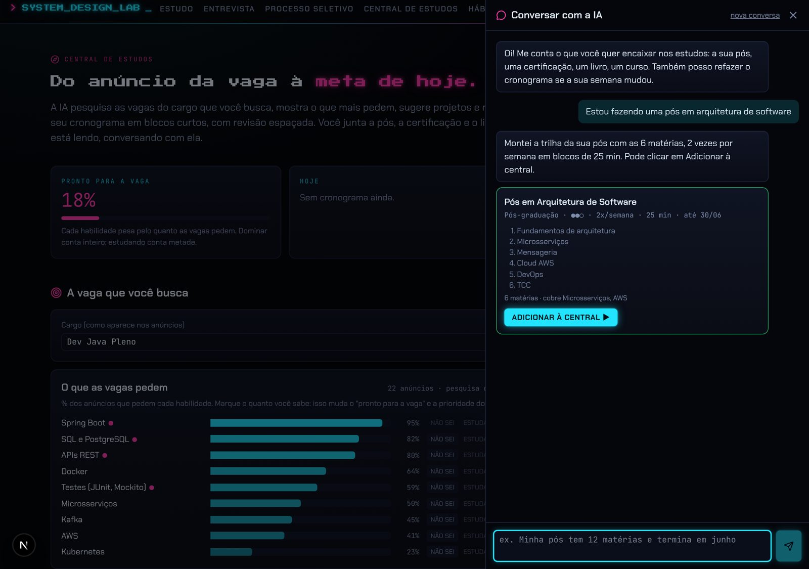
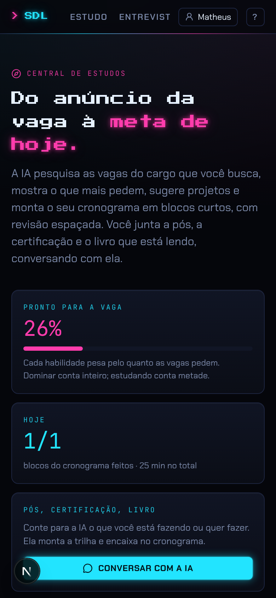

# Feature 3: Central de estudos (`/estudos`)

> **Do anúncio da vaga à meta de hoje.** A IA pesquisa vagas reais do cargo na web, mostra o que mais pedem (em % dos anúncios), calcula o quanto você está pronto, sugere projetos de portfólio, e monta um cronograma dia a dia em **blocos curtos com revisão espaçada**. Você junta a sua pós, certificação, livro ou curso conversando com ela.

Leia antes o [design system](README.md#design-system-compartilhado-terminal-neon) e a [integração local com a IA](README.md#integração-local-com-a-ia-vale-para-as-4-features). Esta feature **só existe no PR #6** (branch `claude/project-thread-sdljix`, commit `f8213fe`); não está na `main`. Núcleo puro: [`anexos/study-core.ts`](anexos/study-core.ts) (`packages/study`). Prompts: `packages/ai/src/study.ts`.

Cor-assinatura: **magenta** (`--accent-2`), com ciano para "hoje" e verde para feito.

Depende de: conta e perfil ativo (feature 4: cada perfil = stack + senioridade tem a sua central) e banco.

---

## 1. Tela

Container `max-w-6xl`, `py-12`. Uma página longa, em seções com âncoras (`#vaga`, `#lacunas`, `#trilhas`, `#projetos`, `#cronograma`).

### Cabeçalho

- `hud-label` magenta com bússola: "CENTRAL DE ESTUDOS".
- Título Press Start 2P: "Do anúncio da vaga à **meta de hoje.**" (parte final magenta com glow).
- Texto: "A IA pesquisa as vagas do cargo que você busca, mostra o que mais pedem, sugere projetos e monta o seu cronograma em blocos curtos, com revisão espaçada. Você junta a pós, a certificação e o livro que está lendo, conversando com ela."
- Estados vazios em `panel`: sem banco ("O banco não abriu…"), sem conta ("Entre na sua conta para ter a sua central. É só um clique, sem senha." + ENTRAR ▶), sem perfil ("Crie um perfil…" + CRIAR PERFIL ▶).

### Hero (3 cards, `md:grid-cols-3`)

1. **PRONTO PARA A VAGA**: "62%" em mono 3xl magenta + barra magenta de 6px + "Cada habilidade pesa pelo quanto as vagas pedem. Dominar conta inteiro; estudando conta metade." (antes da pesquisa: "Aparece depois da pesquisa da vaga.").
2. **HOJE** (link para `#cronograma`, hover borda ciano): "1/3" em mono 3xl ciano + "blocos do cronograma feitos · 45 min no total"; sem nada hoje: "Nada planejado hoje: descanso combinado."
3. **PÓS, CERTIFICAÇÃO, LIVRO**: "Conte para a IA o que você está fazendo ou quer fazer. Ela monta a trilha e encaixa no cronograma." + botão neon "💬 CONVERSAR COM A IA".

### Seção "A vaga que você busca" (alvo magenta)

- Campo "Cargo (como aparece nos anúncios)" (ex. "Desenvolvedor Java Pleno"; padrão = nome da vaga do perfil), "Salvar cargo" quando muda, e o botão **PESQUISAR AS VAGAS** / "Pesquisar de novo" / "Pesquisando…" (spinner).
- Durante a pesquisa: "A IA está lendo anúncios reais na web (LinkedIn, Gupy, Glassdoor…). Leva de 3 a 10 minutos e usa o limite da sua assinatura. Pode sair da página: a pesquisa continua e fica salva." A tela recarrega a cada 5s enquanto o status é `running`.
- Avisos: sem pesquisa ("Ela fica salva e vale por 6 meses."), erro em vermelho, pesquisa com mais de 6 meses em amarelo.

Resultado (`lg:grid-cols-[1fr_320px]`):
- **"O que as vagas pedem"** + "28 anúncios · pesquisa de 03/11/2026". Uma linha por habilidade (grade nome | barra | nível): nome (com ● magenta se obrigatório na maioria), **barra horizontal ciano** com largura = % e opacidade `0,35 + 0,65 × %`, o "%" em mono, e três botões minúsculos **NÃO SEI / ESTUDANDO / DOMINO** (cinza, amarelo, verde; o marcado à mão ganha anel). Clicar de novo no marcado desmarca (volta ao automático).
- Coluna direita: "RESUMO DO MERCADO" (3 a 5 frases + "Faixa CLT: R$ 6.000 a R$ 11.500" em verde), "O QUE CAI NAS ENTREVISTAS" (recolhido) e as fontes (um link por anúncio lido).

### Seção "O que mais falta para a vaga" (alvo amarelo)

As até 8 habilidades mais pedidas que você não domina, ordenadas por `frequência × (2 − nível)`. "O cronograma dá prioridade a elas e às que tiveram nota baixa nas suas entrevistas."

### Seção "Suas trilhas"

- Tipos: Pós-graduação (matérias), Certificação (módulos), Livro (capítulos), Curso (aulas), Projeto (entregas), Outro (etapas).
- Card por trilha: tipo, título, por que importa, resumo ("essencial para a vaga · 2× por semana · 25 min · até 15/03"), progresso "4 de 12 capítulos" com barra, selects para mudar vezes por semana e minutos por sessão na hora, lista de unidades com check, e lixeira para remover (com confirmação).
- Formulário manual (`md:grid-cols-2`): tipo, nome, por quê, importância (3 essencial para a vaga, 2 importante, 1 quando sobrar tempo), vezes por semana (1 a 7), minutos por sessão (10 a 120), prazo, habilidades, unidades (uma por linha).
- Vazio: "Nenhuma trilha ainda. Adicione a sua pós, uma certificação, o livro que está lendo ou um projeto sugerido abaixo."
- Limites: 20 trilhas, 60 unidades por trilha.

### Seção "Projetos para o portfólio"

- Botão que pede à IA **3 projetos** a partir da pesquisa ("cerca de 1 minuto"). Sem pesquisa: "Os projetos saem da pesquisa da vaga: pesquise primeiro."
- Card por projeto: título, pitch (por que impressiona numa entrevista), habilidades, semanas, "Entregas" recolhidas, botão "Escolher este ▶" ("Já está nas trilhas" depois) → vira uma trilha do tipo Projeto (importância 3, 3× por semana, 30 min, unidades = entregas).

### Seção "Cronograma"

- `panel` "SEU TEMPO LIVRE": 7 selects (seg a dom, minutos ou "folga"; grade 4 colunas no celular, 7 no desktop), total da semana ("5h15 por semana"), "pronto até" (data alvo) e "folga para imprevistos" (0 a 50%, padrão 20%). Botão "Salvar".
- Botão neon **REPLANEJAR A PARTIR DE HOJE** (ou **MONTAR O CRONOGRAMA** na primeira vez; "Montando…" com spinner e "A IA está encaixando as trilhas no seu tempo (1 a 3 minutos)…").
- Botão "Pôr o cronograma na meta do dia (placa-mãe)": adiciona o item "Cumprir o cronograma do dia (Central de estudos)" à meta do hábito. Depois aparece em verde "O cronograma faz parte da sua meta do dia."
- Aviso amarelo "Hora de replanejar: é domingo ou o cronograma está acabando. O que já passou não muda."
- As notas da IA para a quinzena, em cinza.
- **Um card por dia** (`panel p-3`): cabeçalho "Hoje 03/11" (borda ciano) ou "qua 04/11", e à direita "1/1 · 25 de 36 min" (feitos e minutos usados do disponível). Dias passados incompletos ficam a 70%.
- Cada bloco: checkbox verde, título ("Ler cap. 3 do DDIA: armazenamento"), linha cinza com a trilha e o porquê, tipo em mono colorido (**ESTUDO** ciano, **REVISÃO** amarelo, **TREINO COM NOTA** magenta, **PROJETO** verde) e "25 min". Feito: borda e título verdes. Marca na hora (otimista) e o servidor confirma. Só dá para marcar hoje e ontem.
- "Próximas semanas (esboço)" recolhido: uma linha por semana com o foco.

### Conversa com a IA (painel lateral)

- Drawer à direita (`max-w-lg`, altura total, borda esquerda, fundo `--bg`, sobreposição preta a 50%). Cabeçalho "💬 Conversar com a IA", "nova conversa", fechar.
- Mensagem inicial: "Oi! Me conta o que você quer encaixar nos estudos: a sua pós, uma certificação, um livro, um curso. Também posso refazer o cronograma se a sua semana mudou."
- Sugestões clicáveis (`btn-ghost`): "Estou fazendo uma pós em arquitetura de software", "Quero tirar a certificação AWS Solutions Architect Associate", "Vou ler Designing Data-Intensive Applications", "Semana que vem tenho pouco tempo, refaz o cronograma".
- Bolhas: usuário à direita com fundo ciano a 15%; IA à esquerda em `panel`.
- Quando a IA propõe uma trilha, aparece um card com borda verde: título, resumo, unidades numeradas (rolagem até 160px) e **ADICIONAR À CENTRAL** (desabilita depois de usado).
- Quando a IA combina uma mudança ("replan"), aparece "↻ Refazer o cronograma".
- "pensando… (pode buscar na web, leva até 1 minuto)". Conversa guardada no `localStorage` por perfil.

### Celular

Todas as grades viram uma coluna; a linha da habilidade encolhe o nome (`10rem`); o drawer ocupa a tela toda.

---

## 2. Regras (núcleo puro, `packages/study`)

- **Pesquisa** vale 180 dias. Id = `slug(cargo):nível`. É reaproveitada entre perfis com o mesmo cargo e nível. Pesquisa "rodando" há mais de 30 min é considerada travada e pode ser refeita. Em erro, mantém a anterior e mostra a mensagem.
- **Limpeza** de tudo que vem da IA ou da tela (`clean*`): textos cortados, números limitados, habilidades sem duplicatas (até 40, ordenadas por frequência), faixa só se fizer sentido, fontes só com `http(s)`.
- **Nível de cada habilidade**: o que você marcou; se não marcou, "estudando" quando algum bloco feito do cronograma ou unidade concluída de trilha trata dela; senão "não sei".
- **Pronto para a vaga** = Σ(peso × nível/2) / Σ peso, com peso = `max(1, frequência)`. Dominar = 1, estudando = 0,5.
- **Disponibilidade**: minutos por dia da semana (padrão seg-sex 45, sáb 90, dom 0), folga (padrão 20%). Minutos planejáveis no dia = minutos × (1 − folga).
- **Cronograma**: detalha **14 dias** (`HORIZON`); o resto vira esboço semanal (até 12 semanas, até a data alvo).
  - O replanejamento começa **hoje**, a não ser que você já tenha marcado algo de hoje (aí começa amanhã). **O passado nunca muda**: os itens anteriores ao início são mantidos e unidos ao novo plano. Guarda 60 dias de passado.
  - Precisa replanejar quando faltam menos de 2 dias para acabar ou quando é domingo e ainda não foi refeito hoje.
  - Na limpeza, um item que **não cabe** no tempo que sobra no dia é descartado (nunca passa do seu tempo). Itens fora do período são descartados. `trailId`/`unitId` só valem se existirem.
  - Dia do cronograma com tudo marcado = feito; dia sem nada planejado dentro do cronograma = descanso combinado (conta como feito para a meta do hábito).
  - Marcar um bloco que é de uma unidade de trilha conclui a unidade (desmarcar desfaz).

## 3. IA (prompts, `packages/ai/src/study.ts`)

Todas usam a integração local do Claude Code com saída validada por JSON Schema.

### Pesquisa das vagas (com web, até 20 min)

Sistema: "pesquisador de mercado de trabalho de tecnologia no Brasil. Faz SEMPRE a mesma pesquisa, com o mesmo método". Método:
1. Buscar vagas reais e recentes (últimos 90 dias), do cargo e do nível no Brasil, incluindo remotas, em várias fontes (LinkedIn Vagas, Gupy, Glassdoor, Indeed, Programathor, Remotar, Catho, sites de carreira).
2. Abrir e ler de 15 a 30 anúncios diferentes, anotando obrigatório e diferencial.
3. `frequency` = % dos anúncios lidos que pedem a habilidade; agrupar sinônimos; `must` = obrigatório na maioria.
4. Faixa salarial mensal CLT (`band` = [mín, máx] ou []).
5. Temas que mais caem em entrevistas (`questions`).
Regras: `postingsAnalyzed` real, nunca inventado; 12 a 30 habilidades com categoria curta (Linguagem, Framework, Banco de dados, Mensageria, Nuvem, DevOps, Arquitetura, Testes, Práticas, Comportamental); um link por anúncio e por fonte de salário; `summary` de 3 a 5 frases; nada inventado.
Entrada: cargo, nível, tecnologias da stack do perfil como ponto de partida, data de hoje.
Saída: `{ summary, postingsAnalyzed, skills[{name, frequency, category, must}], band[], questions[], sources[{label, url}] }`.

### Contexto comum (enviado na conversa, nos projetos e no cronograma)

Vaga alvo e data alvo; habilidades com % e o que ele sabe; trilhas com id, tipo, importância, frequência, sessão, prazo, habilidades e as unidades **pendentes** com ids; tempo livre por dia e folga; combinados ("sábado não estudo"); últimas 8 entrevistas da plataforma com nota e o que faltou.

### Conversa (com web, até 5 min)

Coach de estudos, curto (até 5 frases), "como um colega que entende de carreira". Três ações:
1. `add_trail`: descobrir só o que falta (nome exato e por quê; unidades, propondo a lista quando é algo público e conhecido, com busca na web; prazo; vezes por semana, sugerindo 1 a 3; sessões curtas de 15 a 30 min; importância 1 a 3 com base nas vagas). Quando tiver o suficiente, devolve a trilha completa e diz para clicar em "Adicionar à central".
2. `replan`: quando ele pede ou conta algo que muda a semana, escreve o combinado em `note` (uma frase) e diz que vai refazer.
3. `none`: responde, lembrando o que é mais importante para a vaga.
Saída: `{ reply, action, trail{kind, title, why, importance, perWeek, sessionMin, deadline, skills[], units[]}, note }` (trilha vazia quando não é `add_trail`). Os combinados se acumulam nas notas da disponibilidade.

### Projetos

Tech lead que monta portfólio: **exatamente 3** projetos diferentes que juntos cobrem as habilidades mais pedidas que ele não domina, um deles menor (2 a 4 semanas), realistas de empresa (ex. API de pagamentos com fila e idempotência). `pitch` de 2 a 3 frases, `skills` com os mesmos nomes da pesquisa, 4 a 10 entregas pequenas em ordem, `weeks`.

### Cronograma (até 6 min)

"O objetivo é ele conseguir a vaga sem largar o plano." Regras: nunca passar dos minutos do dia (dia com 0 é descanso); maioria dos blocos de 10 a 30 min, vários por dia; cada trilha só nas vezes por semana combinadas, espalhadas; unidades em ordem, com `trailId`/`unitId`; prioridade = prazo, importância, habilidades muito pedidas que ele não domina cruzadas com o que faltou nas entrevistas; **revisão espaçada sempre** (revisão curta 1 a 3 dias depois e outra cerca de uma semana depois; revisar é se testar, não reler); 1 a 2 "teste" por semana (treino de entrevista com nota na plataforma sobre o tema da semana); o que ficou para trás volta primeiro, sem acumular; `title` = ação concreta; `why` = meia frase; `outline` semanal; `notes` de 2 a 4 frases.
Entrada adicional: os 14 dias com os minutos de cada um, e como foi o cronograma anterior (feitos, total, o que ficou para trás).
Saída: `{ notes, outline[{week, focus}], items[{day, title, kind, minutes, trailId, unitId, skill, why}] }`.

## 4. API

| Rota | O que faz |
|---|---|
| `GET /api/estudos` | Tudo da central do perfil ativo: centro, pesquisa (status, erro, dados), níveis, pronto %, lacunas, marcas dos últimos 60 dias, se precisa replanejar |
| `PATCH /api/estudos` | `{ op }`: `role`, `availability`, `skill`, `trail-add`, `trail-update`, `trail-remove`, `unit`, `project-choose` |
| `POST /api/estudos/pesquisa` | Começa a pesquisa **em segundo plano** (responde na hora com `running`; grava `done` ou `error` ao terminar) |
| `POST /api/estudos/conversa` | Uma rodada da conversa |
| `POST /api/estudos/projetos` | Gera os 3 projetos |
| `POST /api/estudos/cronograma` | Gera ou refaz os próximos 14 dias |
| `POST /api/estudos/feito` | Marca/desmarca um bloco (hoje ou ontem) |

## 5. Dados

| Tabela | Campos |
|---|---|
| `study_centers` | `profile_id` (PK), `target_role`, `availability jsonb` (minutos[7], data alvo, folga, combinados), `trails jsonb`, `project_options jsonb`, `skill_status jsonb` (`{ habilidade: 0 \| 1 \| 2 }`), `schedule jsonb` (`{ createdAt, from, until, items[], outline[], notes }`), `updated_at` |
| `role_research` | `id` ("cargo-normalizado:nível"), `role`, `level`, `status` (running \| done \| error), `data jsonb`, `error`, `started_at`, `researched_at` |
| `checkins` (compartilhada com o hábito) | marcas de bloco feito como `item_id = "c:<id do bloco>"` por perfil e dia |

## 6. Para replicar (checklist)

1. Núcleo puro (`anexos/study-core.ts`) com as regras e a limpeza.
2. Prompts e schemas da seção 3, chamados pela integração local; a pesquisa roda em segundo plano e a tela faz polling a cada 5s.
3. Página única em seções, com o drawer de conversa.
4. Depende de conta/perfil e de `addDays`/`dayInBrazil` (horário de Brasília) do núcleo do hábito.
5. Integração opcional com o hábito: item de meta "cumprir o cronograma do dia".
