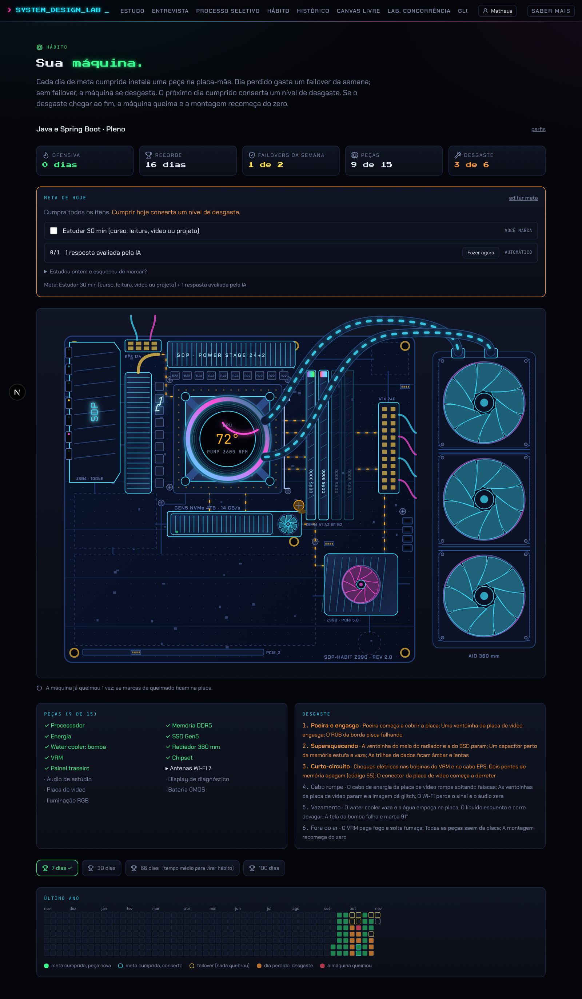
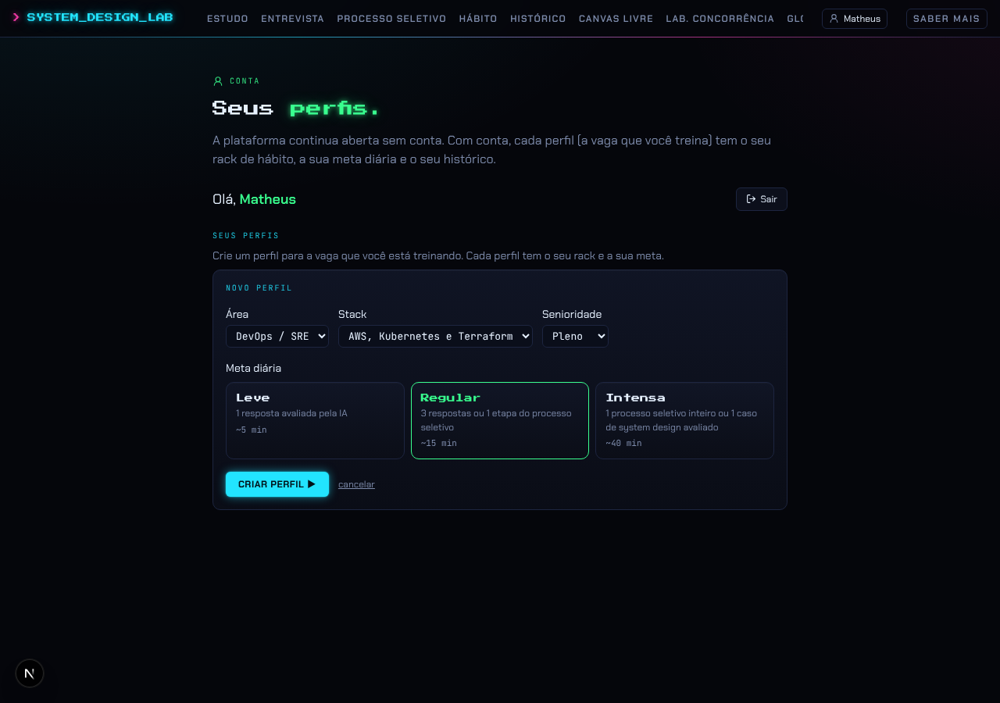
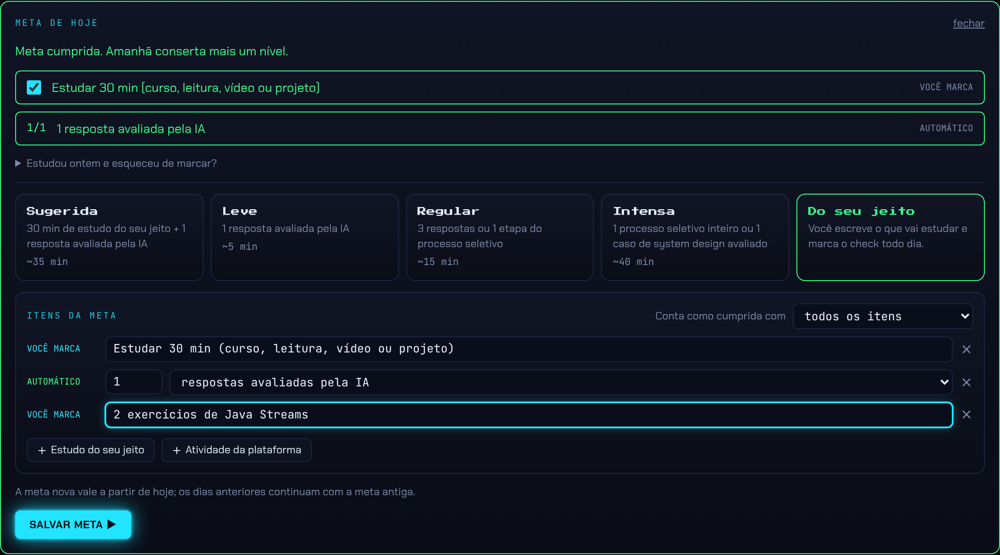
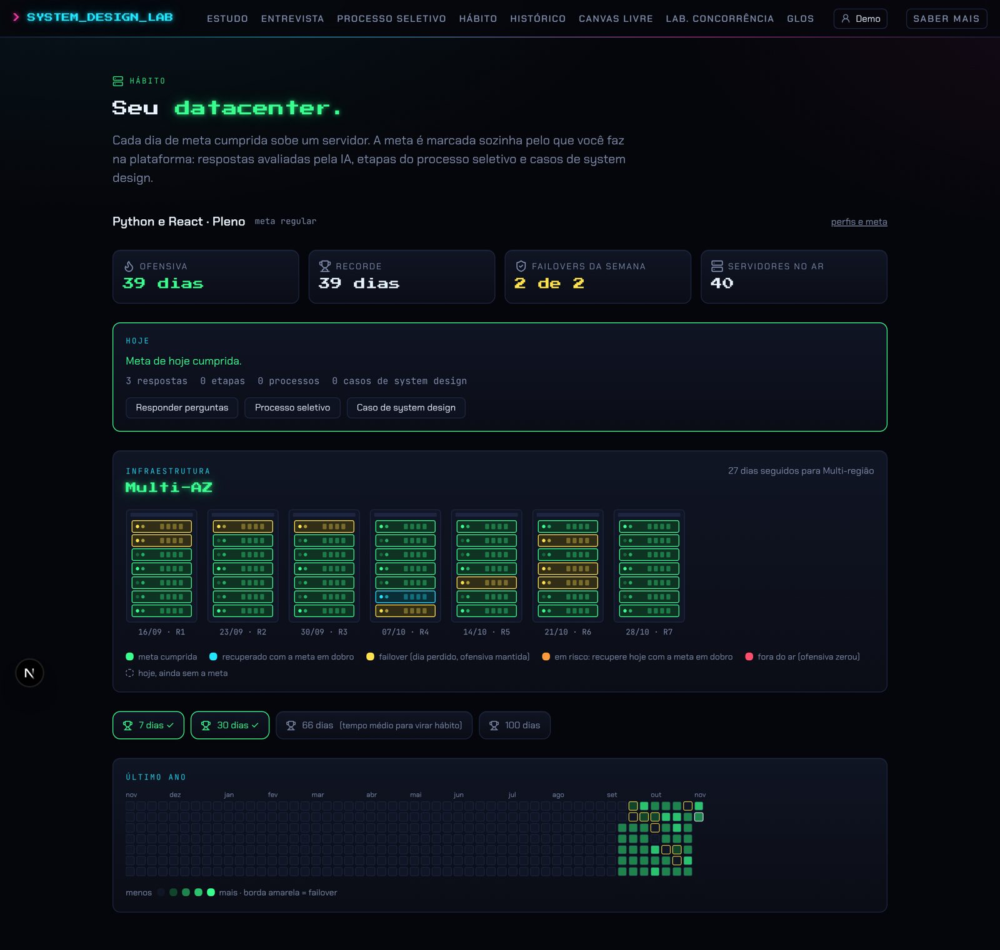
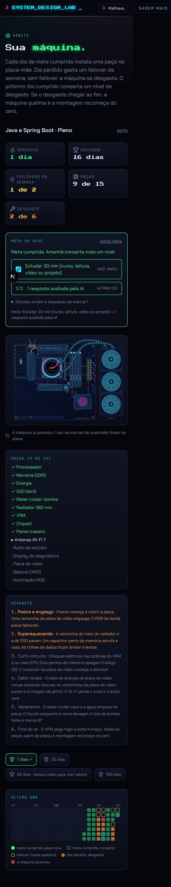

# Feature 4: Hábito com a placa-mãe neon (`/habito`, `/conta`)

> **Sua máquina.** Cada dia de meta cumprida instala uma peça numa placa-mãe neon vista de cima. Dia perdido gasta um *failover* da semana; sem failover, a máquina se desgasta (poeira, superaquecimento, curto, cabo rompido, vazamento, fogo). O próximo dia cumprido conserta um nível. Se o desgaste chegar ao fim, a máquina queima e a montagem recomeça do zero.

Leia antes o [design system](README.md#design-system-compartilhado-terminal-neon). Esta feature **só existe no PR #6** (branch `claude/project-thread-sdljix`, commit `f8213fe`). Arquivos de referência, copiados sem alteração:

- [`anexos/habit-core.ts`](anexos/habit-core.ts): regras puras (`packages/habit`), testadas.
- [`anexos/habito-board.ts`](anexos/habito-board.ts): a placa inteira como string SVG.
- [`anexos/habito-boardFx.ts`](anexos/habito-boardFx.ts): efeitos (faísca, conserto, fogo, choques, ventoinhas).
- [`anexos/habito-Board.tsx`](anexos/habito-Board.tsx): componente que anima o que mudou desde a última visita.
- [`anexos/globals.css`](anexos/globals.css), seção "Hábito: placa-mãe (escopo .mobo)": todos os estilos e keyframes da placa.

Cor-assinatura: **verde** (`--ok`). A ideia visual é do Matheus: placa-mãe vista de cima, cada dia instala um componente com animação, dia perdido mostra dano. Ele escolheu o estilo "neon escuro" e aprovou a mistura: montar peça por peça + desgaste nos dias perdidos + conserto gradual + recomeço ao queimar.

---

## 1. Contas e perfis (`/conta`)

- **Entrada com um clique, sem senha** (uso pessoal). Sem conta: "ENTRAR COMO" com um botão neon por conta existente + "CRIAR CONTA" (campo nome, "Criar e entrar ▶", "Por enquanto é só clicar e entrar, sem senha. Login com Google e GitHub vem depois.").
- Sessão = dois cookies httpOnly de 1 ano: `sdl_uid` (conta) e `sdl_pid` (perfil ativo). O plano futuro é login único (Auth.js com Google/GitHub, JWT em cookie compartilhado entre os apps).
- Logado: "Olá, **Matheus**" (verde) e botão Sair.
- **"SEUS PERFIS"**: um perfil = uma vaga que você treina (**stack + senioridade**), cada um com **a sua meta e a sua placa-mãe**. Card por perfil: título ("Java e Spring Boot · Pleno"), "desde 03/11/2026", "Meta diária: <resumo>", botões "editar meta" e "usar este" (ou selo verde "ATIVO"; o ativo tem borda verde).
- **Novo perfil**: selects de área, stack e senioridade (avisa se a vaga ainda não tem processo seletivo, "mas as respostas e os casos de system design contam para a meta"), editor de meta (começa na sugerida), "Criar perfil ▶". Não deixa duplicar.
- **Chip no cabeçalho** (todas as páginas): ícone de pessoa + nome; hover verde; leva a `/conta`. Sem conta, "ENTRAR". O evento de janela `conta-mudou` atualiza o chip quando algo muda.

## 2. A meta do dia

A meta é uma lista de **itens** com modo **todos** ou **qualquer um**:

| Tipo de item | Como conta |
|---|---|
| `platform` (automático) | Atividades feitas na plataforma, marcadas sozinhas: respostas avaliadas pela IA (`answers`), etapas de processo seletivo (`stages`), processos inteiros (`processes`), casos de system design avaliados (`designs`) e avanços em projetos do portfólio (`projects`: dia com commit relevante ou passo concluído, vindos da Central de estudos). Com alvo de 1 a 20 |
| `manual` ("você marca") | Texto livre do seu tipo de estudo ("1 hora de Spring Boot"); você marca o check |
| `schedule` (automático) | "Cumprir o cronograma do dia (Central de estudos)": cumprido quando todos os blocos do dia foram feitos (feature 3) |

Modelos prontos (cards no editor, com "~N min"):

| Modelo | Regra |
|---|---|
| **Sugerida** (padrão) | 30 min de estudo do seu jeito (manual) **+** 1 resposta avaliada pela IA (~35 min) |
| Leve | 1 resposta avaliada pela IA (~5 min) |
| Regular | 3 respostas **ou** 1 etapa do processo seletivo (~15 min) |
| Intensa | 1 processo seletivo inteiro **ou** 1 caso de system design avaliado (~40 min) |
| Do seu jeito | Você monta os itens (até 8) |

Editor: 5 cards em grade (`sm:grid-cols-5`, título em Press Start 2P 10px, selecionado com borda verde) + painel "ITENS DA META" com o select "todos os itens / qualquer um dos itens", uma linha por item (rótulo mono "VOCÊ MARCA" ciano ou "AUTOMÁTICO" verde, campo de texto ou alvo + métrica, lixeira) e botões "+ item seu", "+ item da plataforma", "+ cronograma do dia".

**Trocar a meta não reescreve o passado**: o perfil guarda `plan_history` (`[{ until, plan }]`) e cada dia é julgado com a meta que valia nele. "A meta nova vale a partir de hoje; os dias anteriores continuam com a meta antiga."

Marcar item manual: só **hoje ou ontem** ("Estudou ontem e esqueceu de marcar?" aparece quando ontem não foi cumprido).

## 3. Regras da placa (núcleo puro)

Datas sempre no **horário de Brasília** (`America/Sao_Paulo`), formato `AAAA-MM-DD`. A semana dos failovers começa na segunda.

Para cada dia, do primeiro dia do perfil até hoje:

1. **Meta cumprida**:
   - se há desgaste → **repair**: conserta 1 nível;
   - senão, se faltam peças → **install**: instala a próxima peça (ordem fixa abaixo);
   - senão → **overclock** +1 (as ventoinhas giram mais rápido).
   A ofensiva (`streak`) soma 1.
2. **Hoje sem a meta** → `today` (ainda não conta como perdido).
3. **Dia perdido** com failover sobrando na semana (padrão **2 por semana**) → **failover**: nada quebra (a ofensiva não soma nem zera).
4. **Dia perdido sem failover** → **wear**: desgaste +1 e a ofensiva zera. Se o desgaste chega a **6** → **burn**: a placa esvazia (peças, desgaste e overclock voltam a 0) e conta um *reboot*.

Saída (`HabitSummary`): dias com estado, placa `{ parts 0-15, wear 0-5, overclock, reboots }`, ofensiva, recorde, dias cumpridos, failovers restantes na semana, contagens e marcas de hoje, se hoje foi cumprido e os marcos **7, 30, 66 e 100 dias** (66 = "tempo médio para virar hábito").

Intensidade do calendário (0 a 4): 0 sem atividade; 1 fez algo mas não cumpriu; 2 a 4 conforme quantas vezes passou dos alvos.

### As 15 peças, na ordem de instalação

| # | Peça | Detalhe visual |
|---|---|---|
| 1 | Processador | IHS metálico, núcleos pulsando, "SDP CORE ULTRA 9 · 24C/32T · 5.8 GHz · 3 nm" |
| 2 | Memória DDR5 | 4 pentes com dissipador e RGB correndo (hue-rotate) |
| 3 | Energia | 24 pinos e EPS 8 pinos com cabos trançados ciano/magenta |
| 4 | SSD Gen5 | dissipador com ventoinha própria, "GEN5 NVMe 4TB · 14 GB/s" |
| 5 | Water cooler: bomba | cobre o processador; tela redonda com a temperatura ("42°", "PUMP 2800 RPM"), anel gradiente girando |
| 6 | Radiador 360 mm | 3 ventoinhas grandes à direita da placa e mangueiras com líquido correndo |
| 7 | VRM | dissipadores, heatpipe dourado e bobinas "R22", "SDP · POWER STAGE 24+2" |
| 8 | Chipset | dissipador com ventoinha magenta, "Z990 · PCIe 5.0" |
| 9 | Painel traseiro | USB4, rede 10 GbE com LEDs, logo "SDP" vertical |
| 10 | Antenas Wi-Fi 7 | ondas de sinal pulsando |
| 11 | Áudio de estúdio | capacitores dourados e equalizador magenta |
| 12 | Display de diagnóstico | código POST em 7 segmentos vermelho e LEDs CPU/DRAM/VGA/BOOT |
| 13 | Placa de vídeo | 3 ventoinhas, backplate, RGB, "SDP RTX 9090 · 32 GB" |
| 14 | Bateria CMOS | "CR2032" |
| 15 | Iluminação RGB | contorno da placa e faixa lateral com gradiente arco-íris girando |

### Os 6 níveis de desgaste

| Nível | Nome | O que acontece na placa |
|---|---|---|
| 1 | Poeira e engasgo | poeira começa a cobrir a placa; uma ventoinha da placa de vídeo engasga; o RGB da borda pisca falhando |
| 2 | Superaquecendo | a ventoinha do meio do radiador e a do SSD param; um capacitor perto da memória estufa e vaza; as trilhas de dados ficam âmbar e lentas |
| 3 | Curto-circuito | choques elétricos nas bobinas do VRM e no cabo EPS; dois pentes de memória apagam (código 55); o conector da placa de vídeo começa a derreter |
| 4 | Cabo rompe | o cabo de energia da placa de vídeo rompe soltando faíscas; as ventoinhas da placa de vídeo param e a imagem dá glitch; Wi-Fi perde o sinal e o áudio zera |
| 5 | Vazamento | o water cooler vaza e a água empoça; o líquido esquenta (laranja) e corre devagar; a tela da bomba falha e marca 91° |
| 6 | Fora do ar | o VRM pega fogo e solta fumaça; todas as peças saem da placa; a montagem recomeça do zero |

Temperatura na tela da bomba por nível: 34, 41, 63, 72, 78, 91, 99 °C (amarela a partir do 2, vermelha a partir do 4, tremendo a partir do 5). Rotação: 2800 RPM normal, 3600 (níveis 2 a 4), 900 (5), 0 (6). Código POST: durante a montagem `B0 + peças` em hexa; com desgaste `A0, A0, 9A, 55, d6, 00, FF`. LEDs do display ficam vermelhos conforme o nível (VGA a partir do 4, DRAM a partir do 3, CPU a partir do 5).

---

## 4. A placa-mãe (visual)

### Geometria

- SVG `viewBox="0 0 830 600"`, escala pela largura (`w-full h-auto`), dentro de um `panel` com `p-2` e a classe de escopo `.mobo`.
- **PCB**: retângulo `x40 y40 580x540 rx12`, gradiente `#0a1430 → #060c1d`, borda `#22396e`. Por cima: linhas de camada a cada 80px, grade de pontinhos a cada 20px, 70 SMDs pseudoaleatórios (seed fixa), 6 furos dourados, capacitores, portas SATA, slot PCIE_2, conectores de ventoinha, serigrafia "SDP-HABIT Z990 · REV 2.0" (fonte 8px, `#5f79b8`, `letter-spacing .08em`).
- **Slots vazios**: retângulos tracejados (`4 4`) a 40% marcando onde cada peça vai entrar; somem quando a peça entra.
- **Radiador** fica fora da PCB, à direita (`x650 y66 170x490`), com as mangueiras saindo da bomba em curvas.
- Centro de cada peça (para os efeitos): cpu/pump (310,210), ram (482,220), power (576,225), ssd (320,351), radiator (735,310), vrm (300,75), chipset (530,450), io (88,165), wifi (24,120), audio (120,345), debug (580,78), gpu (255,475), cmos (545,548), rgb (330,310).
- Ordem de desenho (de baixo para cima): vrm, cpu, ram, power, ssd, pump, chipset, io, wifi, audio, debug, gpu, cmos, rgb, radiator.

### Paleta da placa

`--lit #3fe0ff` (ciano), `--pink #ff4dd8`, `--green #39ff8f`, `--gold #ffd24d`, `--violet #b78cff`. Metal em gradiente `#1b2b52 → #101b38 → #18284c`. Chips `#0e1730` com borda ciano (apagados `#2c4a86`). Pinos dourados `#d9b44a`.

### Trilhas que acendem

24 trilhas ligando pares de peças (ex. cpu↔ram, ssd↔chipset, chipset↔gpu). Cada trilha tem um traço escuro de base e um traço "flow" ciano tracejado (`3 11`) correndo (`mb-flow` 1.3s) que **só acende quando as duas peças estão instaladas**. Com desgaste 2 ficam âmbar e lentas; com 4, vermelhas; com 6, quase apagadas.

### Ventoinhas

Desenho paramétrico: placa redonda, anel gradiente girando (`ciano → violeta → magenta`), N pás curvas translúcidas (ciano ou magenta), cubo central. As pás giram com `--fan` (1.1s; overclock diminui 0,03s por ponto, mínimo 0,3s). Ventoinhas nomeadas: gpu1/2/3, rad1/2/3, ssd, chip.

### Animações de instalação, conserto e queima

O componente guarda no `localStorage` (`sdp-placa-<perfil>`) o último estado que você viu. Ao abrir a página (ou ao cumprir a meta), ele **anima só o que mudou desde então**, um passo por segundo (400ms + 1000ms por passo):

- **Peça nova**: a peça cai na placa (`mb-drop` 0,75s: vem de 40px acima com escala 1,3, quica com `cubic-bezier(.2,1.5,.4,1)`), faísca amarela em 12 raios e o rótulo flutuante "+ Processador" subindo e sumindo (1,7s). Se entraram muitas peças, as mais antigas aparecem direto e só as **últimas 5** animam.
- **Desgaste novo**: aplica a classe `d1…d6` no SVG, faísca laranja e rótulo vermelho ("engasgou", "superaquecendo", "curto-circuito!", "cabo rompeu!", "vazamento!", "fora do ar").
- **Conserto**: ícone de chave verde com raios, rótulo "consertado" verde e as **ventoinhas voltando aos poucos**, uma depois da outra (900ms entre elas): pulso verde, giro lento (5s), normal (2,4s), um **pico mais forte** (1,1s → 0,35s) e estabiliza.
- **Overclock**: rótulo "overclock +N" verde e ventoinhas mais rápidas.
- **Queimou** desde a última visita: rótulo "a máquina queimou" sobre o VRM, fogo em 3 camadas (vermelho, laranja, amarelo, tremendo 0,21 a 0,34s) com fumaça cinza subindo; após 2,4s as peças **saem uma a uma** em ordem inversa (110ms cada, caindo e girando 6°), a placa volta vazia e a montagem recomeça animando o que já foi feito depois. Fica uma **marca de queimado** (elipse preta borrada) por reboot, até 4.

### Efeitos de desgaste (classes cumulativas `d1…d6` no `<svg>`)

- **d1**: poeira (pontinhos cinza) aparece; `gpu2` engasga (`mb-stutter`: gira, quase para, volta); RGB pisca falhando.
- **d2**: `rad2` e `ssd` param; `chip` fica lento (3,2s); capacitor estufa (escala 1,4, âmbar) e vaza; trilhas âmbar e lentas; anéis a 50%.
- **d3**: mais poeira; pentes de RAM 3 e 4 apagam; conector da GPU brilha laranja pulsando; `rad1` engasga; **choques elétricos** (raios em ziguezague azul-claro gerados a cada 120ms nas bobinas do VRM e no cabo EPS, com faíscas).
- **d4**: cabo da GPU troca para a versão rompida com faíscas amarelas; ventoinhas da GPU param; **glitch** de faixas coloridas sobre a placa de vídeo; trilhas vermelhas e lentas; Wi-Fi sem ondas; equalizador zera; RGB da RAM pisca.
- **d5**: líquido laranja e lento; poça ciano borrada; gotas pingando da bomba; `rad3` para; anel da bomba a 12s; peças dessaturadas.
- **d6**: tudo para (pás, anéis, LEDs, líquido), trilhas a 12%, RGB a 8%, peças escuras e sem cor, PCB quase preta, **fogo e fumaça no VRM**.

Com `prefers-reduced-motion`, tudo fica parado.

---

## 5. A tela `/habito`

Container `max-w-6xl`, coluna com `gap-6`:

1. Cabeçalho: "HÁBITO" verde com chip, "Sua **máquina.**" (verde com glow) e o texto de regras.
2. Linha do perfil: título da vaga, select para trocar de perfil (se houver mais de um) e link "perfis".
3. **5 estatísticas** (`grid-cols-2 sm:grid-cols-5`), `panel` com rótulo pequeno em MAIÚSCULAS e valor em Press Start 2P 13px: **Ofensiva** (verde, Flame), **Recorde** (Trophy), **Failovers da semana** "1 de 2" (amarelo; vermelho se 0, ShieldCheck), **Peças** "9 de 15" (ou "15 · OC +3"), **Desgaste** "3 de 6" (laranja se > 0).
4. **Meta de hoje** (`panel`, borda verde se cumprida, laranja se há desgaste): "Cumpra todos os itens." / "Qualquer um dos itens cumpre a meta." + "Cumprir hoje conserta um nível de desgaste." em laranja; itens como linhas com borda (manual com checkbox verde e "VOCÊ MARCA"; plataforma com "0/1", botão "Fazer agora" para a página certa e "AUTOMÁTICO"; cronograma com "Ver o de hoje"); cumprida: "Meta cumprida. Volte amanhã para a próxima peça." ou "…Amanhã conserta mais um nível."; "editar meta" abre o editor ali mesmo.
5. **A placa-mãe**. Abaixo, se já queimou: "↺ A máquina já queimou 1 vez; as marcas de queimado ficam na placa."
6. Duas colunas (`lg:grid-cols-2`): **PEÇAS (9 DE 15)** em lista de duas colunas (✓ verde instaladas, ▸ branco a próxima, · cinza as futuras; com a placa completa: "Cada dia cumprido agora vira overclock…") e **DESGASTE** (os 6 níveis, os ativos em laranja com o nome em negrito).
7. **Marcos**: chips 7, 30, 66 ("tempo médio para virar hábito") e 100 dias, com troféu; alcançados em verde com ✓.
8. **Último ano** (estilo GitHub): SVG com uma coluna por semana desde 364 dias atrás, quadrados de 11px com 3px de espaço e `rx 2`, nomes dos meses no topo. Cor: verde em 4 intensidades (25% a 100% misturado com o fundo); dia de desgaste laranja e de queima vermelho (70%); failover com contorno amarelo; conserto com contorno ciano; hoje com contorno branco. Tooltip com data, estado e a peça instalada. Rola na horizontal e abre já no fim. Legenda: meta cumprida/peça nova, conserto, failover (nada quebrou), dia perdido/desgaste, a máquina queimou.

Estados vazios em `panel`: sem banco, sem conta ("Entre na sua conta para ter a sua máquina. É só um clique, sem senha."), sem perfil.

### Celular

Estatísticas em 2 colunas, peças e desgaste empilhados, a placa escala inteira na largura (o radiador continua à direita), calendário rolável.

---

## 6. API

| Rota | O que faz |
|---|---|
| `GET /api/conta` | Quem está usando; sem conta, lista as contas para entrar com um clique |
| `POST /api/conta` | `{ name }` cria e entra; `{ userId }` entra |
| `DELETE /api/conta` | Sai |
| `POST /api/perfis` | Cria perfil (stack, level, goal, plan) e deixa ativo; `start_day` = hoje |
| `PATCH /api/perfis` | `{ id, active: true }` troca o ativo; `{ id, goal, plan? }` troca a meta (empurra a antiga para `plan_history`) |
| `GET /api/habito` | Agrega as atividades e marcas dos últimos 370 dias, aplica o item de cronograma, roda `computeHabit` e devolve tudo |
| `POST /api/checkin` | Marca/desmarca item manual (hoje ou ontem) |
| `POST /api/atividade` | `{ kind: "stage" \| "process", ref }` conta etapa/processo (as respostas e casos são contados direto nas rotas de avaliação) |

`logActivity(kind, ref?)` é chamada pelas outras features e **nunca derruba** a rota que chamou: sem banco ou sem perfil, não faz nada. A chave única `(profile_id, kind, ref)` evita contar duas vezes a mesma etapa.

## 7. Dados

| Tabela | Campos |
|---|---|
| `users` | `id uuid`, `name`, `created_at` |
| `profiles` | `id uuid`, `user_id`, `stack`, `level`, `goal` (sugerida \| leve \| regular \| intensa \| personalizada), `plan jsonb` (`{ mode, items }`), `plan_history jsonb` (`[{ until, plan }]`), `start_day` (AAAA-MM-DD, Brasília), `created_at` |
| `activities` | `id bigserial`, `profile_id`, `kind` (answer \| stage \| process \| design), `day`, `ref`, `created_at`; índice único `(profile_id, kind, ref)` e índice `(profile_id, day)` |
| `checkins` | `profile_id`, `day`, `item_id` (PK composta); itens manuais da meta e blocos do cronograma (`c:<id>`) |

O estado da placa **não é guardado**: é sempre recalculado a partir das atividades e marcas, o que permite mudar regras e corrigir o passado. Só o "último estado visto" fica no navegador, para saber o que animar.

No futuro monorepo, este app pode ler as atividades dos outros apps pela API de eventos (`POST /api/eventos` + outbox) em vez de chamadas diretas.

## 8. Para replicar (checklist)

1. Copiar `anexos/habit-core.ts` (regras, testadas) e os testes do pacote.
2. Copiar a placa (`habito-board.ts`, `habito-boardFx.ts`, `habito-Board.tsx`) e a seção `.mobo` do CSS. O SVG é uma string injetada uma vez; tudo depois é troca de classes e efeitos adicionados numa camada `.fxlayer`.
3. Contas e perfis com cookie (ou o login único do monorepo).
4. Tabelas `activities` e `checkins` + a rota que agrega e calcula.
5. Ganchos nas outras features para registrar atividades.
